# ForenziQ – Uživatelská příručka

> **Verze 1.0 · Pouze pro oprávněnou forenzní analýzu**
>
> 🇬🇧 English version: [MANUAL_EN.md](MANUAL_EN.md)

Všechny snímky obrazovky v této příručce vznikly nad **fiktivním ukázkovým případem** (zařízení
„Demo Phone X1“, telefonní čísla z rozsahů vyhrazených pro fikci, adresy `example.com`). Neobsahují žádná
reálná data.

---

## Obsah

1. [Úvod a právní upozornění](#1-úvod-a-právní-upozornění)
2. [Systémové požadavky](#2-systémové-požadavky)
3. [Instalace a spuštění](#3-instalace-a-spuštění)
4. [Příprava zařízení Android](#4-příprava-zařízení-android)
5. [Přehled rozhraní](#5-přehled-rozhraní)
6. [Přehled zařízení](#6-přehled-zařízení)
7. [Extrakce dat (Android přes ADB)](#7-extrakce-dat-android-přes-adb)
8. [Výsledky extrakce, reporty a integrita důkazů](#8-výsledky-extrakce-reporty-a-integrita-důkazů)
9. [Hledání napříč daty](#9-hledání-napříč-daty)
10. [Import zálohy (zálohy výrobců Androidu)](#10-import-zálohy-zálohy-výrobců-androidu)
11. [iOS Extrakce (živé zařízení)](#11-ios-extrakce-živé-zařízení)
12. [iOS Záloha (iTunes / Finder) včetně šifrovaných](#12-ios-záloha-itunes--finder-včetně-šifrovaných)
13. [iOS Ramdisk (checkm8)](#13-ios-ramdisk-checkm8)
14. [Android (dump analyzer)](#14-android-dump-analyzer)
15. [Nokia S30+ (dump analyzer)](#15-nokia-s30-dump-analyzer)
16. [Porovnání záloh](#16-porovnání-záloh)
17. [Časová osa](#17-časová-osa)
18. [Mapa GPS lokací](#18-mapa-gps-lokací)
19. [Obcházení zámku](#19-obcházení-zámku)
20. [Nastavení (branding reportů)](#20-nastavení-branding-reportů)
21. [Bezdrátové připojení (Wi-Fi ADB)](#21-bezdrátové-připojení-wi-fi-adb)
22. [Doporučený postup](#22-doporučený-postup)
23. [Nakládání s daty a soukromí](#23-nakládání-s-daty-a-soukromí)
24. [Řešení problémů](#24-řešení-problémů)

---

## 1. Úvod a právní upozornění

**ForenziQ** je desktopová sada nástrojů pro zajištění a analýzu dat z mobilních zařízení:

- živá extrakce ze zařízení Android přes ADB (USB nebo Wi-Fi),
- analýza fyzických dumpů Androidu (raw / GPT / sparse obrazy, ext4),
- import záloh výrobců Androidu (Samsung, Huawei, Xiaomi, Google, …),
- iOS: živá extrakce, zálohy iTunes/Finder (včetně **šifrovaných**) a akvizice přes SSH ramdisk,
- tlačítkové telefony Nokia S30+ (flash dumpy s čipem Spreadtrum SC6531E),
- analýza: fulltextové **hledání** napříč všemi zdroji, časová osa, mapa GPS, porovnání dvou extrakcí,
- reporty (HTML, PDF, Excel) a **manifest důkazů** (MD5 + SHA-256) pro řetězec důkazů.

Rozhraní je v **angličtině** (výchozí) a v **češtině** – přepínač EN / CS je vlevo nahoře.

### ⚠ Právní upozornění

> Software je určen **výhradně pro zákonnou forenzní analýzu** zařízení, ke kterým máte **výslovné
> oprávnění** (vlastní zařízení, souhlas vlastníka, soudní příkaz nebo obdobný právní základ). Použití bez
> takového oprávnění je protiprávní a může být trestným činem. Autor **nenese žádnou odpovědnost** za
> protiprávní použití. Spuštěním softwaru vyjadřujete souhlas s těmito podmínkami.

---

## 2. Systémové požadavky

| Požadavek | Minimum |
|---|---|
| Operační systém | Windows 10 / 11 (64bit) |
| Python (při spuštění ze zdrojových kódů) | 3.11 nebo novější |
| RAM | 4 GB (doporučeno 8 GB) |
| Místo na disku | 500 MB + místo pro extrahovaná data |
| Internet | Není potřeba. Jen **Mapa** stahuje mapové dlaždice z OpenStreetMap. |

**Balíčky Pythonu** (`requirements.txt`):

| Balíček | Účel |
|---|---|
| customtkinter | Uživatelské rozhraní |
| Pillow | Obrázky, EXIF metadata, náhledy |
| reportlab | PDF reporty |
| openpyxl | Export do Excelu |
| deepdiff | Porovnání záloh |
| tkintermapview | Mapa GPS |
| cryptography | Dešifrování šifrovaných iOS záloh |
| pymobiledevice3 *(volitelný)* | Živá extrakce iOS |
| paramiko *(volitelný)* | Akvizice přes iOS SSH ramdisk |

---

## 3. Instalace a spuštění

### 3.1 Samostatný `.exe` (bez Pythonu)

Pokud máte `ForenziQ.exe`, stačí ho spustit. Vše včetně ADB je zabalené v jediném souboru.

### 3.2 Spuštění ze zdrojových kódů

```bash
pip install -r requirements.txt
python main.py
```

nebo dvojklikem na `run.bat` (použije Python launcher `py`, případně `python` z PATH).

### 3.3 ADB (Android Debug Bridge)

ADB **není součástí repozitáře se zdrojovými kódy** (jde o software Googlu s vlastní licencí). Při
spuštění ze zdrojů si stáhněte **SDK Platform-Tools pro Windows** od Googlu (https://developer.android.com/tools/releases/platform-tools) a buď

- rozbalte obsah složky `platform-tools` do složky `adb/` v projektu (aby existoval `adb/adb.exe`) –
  ForenziQ ho použije automaticky, nebo
- přidejte složku `platform-tools` do systémové proměnné `PATH`.

Stav ADB je zobrazen dole v postranním panelu. Samostatný `ForenziQ.exe` už ADB obsahuje.

### 3.4 Sestavení `.exe`

```bash
pip install pyinstaller
python -m PyInstaller ForenziQ.spec --noconfirm --clean
```

Výsledkem je `dist/ForenziQ.exe` (jediný soubor, cca 60 MB). Pokud při sestavení existuje složka
`adb/`, ADB se do `.exe` přibalí.

---

## 4. Příprava zařízení Android

1. Otevřete **Nastavení → O telefonu** a 7× klepněte na **Číslo sestavení** (odemkne Možnosti pro vývojáře).
2. V **Nastavení → Možnosti pro vývojáře** zapněte **Ladění USB**.
3. Připojte telefon datovým USB kabelem.
4. Odemkněte telefon a potvrďte dotaz **Povolit ladění USB**.

> **Tipy:** Použijte datový kabel (ne jen nabíjecí), zkuste jiný USB port, přepněte režim USB na *Přenos
> souborů* a pokud se zařízení neobjeví, nainstalujte USB ovladač výrobce.

---

## 5. Přehled rozhraní

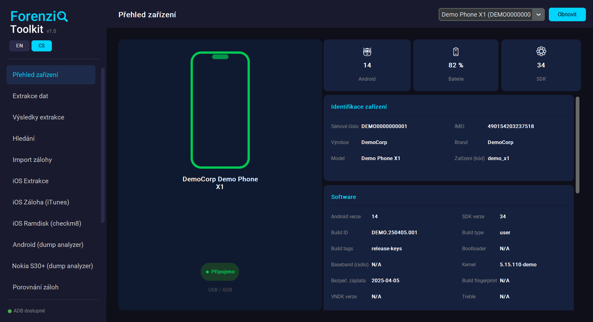

- **Postranní panel (vlevo)** – navigace mezi moduly, přepínač jazyka **EN / CS** (přepne okamžitě, bez
  restartu), **Wi-Fi připojení** a dole stav ADB.
- **Horní lišta** – název aktuálního modulu, seznam připojených zařízení Android a tlačítko **Obnovit**.
- **Pracovní plocha** – aktuální modul. Akční panely mají stejné rozvržení: nahoře lišta (zdroj → stav →
  hlavní akce), vlevo log **Průběh**, vpravo **Moduly**.

---

## 6. Přehled zařízení

Zobrazuje údaje o vybraném zařízení Android: výrobce, model, verzi Androidu, SDK, baterii, sériové číslo,
IMEI, informace o sestavení, bezpečnostní záplatu, jádro, šifrování, SELinux, root, RAM, úložiště, displej
a další. Hodnoty se načtou přes ADB po výběru zařízení.

---

## 7. Extrakce dat (Android přes ADB)

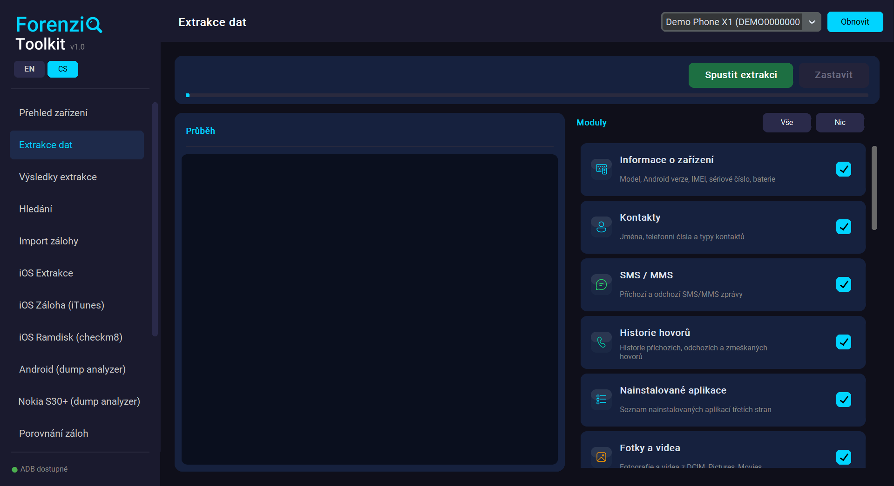

1. Vpravo vyberte moduly (**Vše / Nic** pro rychlý výběr).
2. Klikněte na **Spustit extrakci** a zvolte nadřazenou výstupní složku. Vytvoří se v ní podsložka
   `<model>_<datum>_<čas>`.
3. Průběh sledujte v logu; **Zastavit** extrakci přeruší (data získaná do té doby zůstanou).
4. Po dokončení se data automaticky předají do **Výsledků**, **Časové osy**, **Mapy** a **Hledání**.

| Modul | Data |
|---|---|
| Informace o zařízení | Model, verze Androidu, IMEI, sériové číslo, baterie |
| Kontakty | Jména, telefonní čísla a typy kontaktů |
| SMS / MMS | Přijaté a odeslané zprávy |
| Historie hovorů | Příchozí, odchozí a zmeškané hovory |
| Nainstalované aplikace | Aplikace třetích stran |
| Fotky a videa | Média z DCIM, Pictures, Movies |
| Dokumenty | PDF, dokumenty Office a textové soubory |
| Wi-Fi sítě | Uložené sítě |
| Účty | Účty nastavené v zařízení |
| Historie prohlížeče | Navštívené stránky |
| Uživatelská data (se strukturou) | Kompletní `/sdcard` se zachovanou strukturou složek |
| Analýza souborů (EXIF a metadata) | EXIF, fotoaparát, GPS souřadnice fotek |
| Hashe souborů (MD5, SHA-256) | Kontrolní součty extrahovaných souborů |
| Smazaná data (root) | Obnova smazaných záznamů *(vyžaduje root)* |
| WhatsApp / Viber (root) | Databáze komunikátorů *(vyžaduje root)* |
| ADB záloha aplikací, Root záloha `/data/data`, Data aplikací (Content Providers), Statistiky použití aplikací, Termux Agent | Rozšířené metody akvizice |

> **Tip:** *Hashe souborů* spouštějte jako poslední – počítají součty souborů získaných předchozími moduly.

---

## 8. Výsledky extrakce, reporty a integrita důkazů

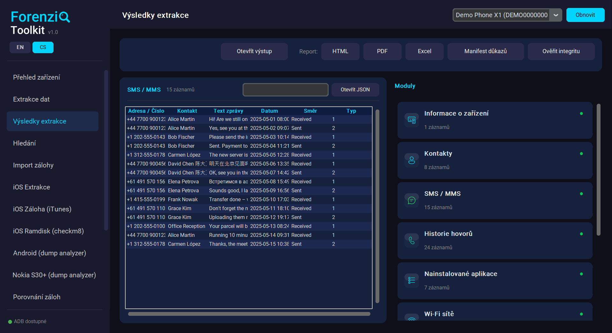

- **Moduly** (vpravo) – karta pro každý modul s počtem záznamů. Kliknutím zobrazíte jeho data.
- **Zobrazení dat** (vlevo) – tabulka (nebo seznam klíč/hodnota) s rychlým filtrem; kliknutím na záhlaví
  sloupce řadíte, **dvojklikem na řádek** otevřete detail záznamu. **Otevřít JSON** otevře zdrojový soubor.
  Moduly s fotkami zobrazí galerii náhledů.
- **Otevřít výstup** otevře výstupní složku.

### 8.1 Reporty

| Tlačítko | Výstup |
|---|---|
| **HTML** | Interaktivní report pro webový prohlížeč |
| **PDF** | Profesionální report: titulní strana (údaje o případu, examinátor, loga), klikací obsah, záložky PDF, záhlaví a zápatí stránek; text lze prohledávat |
| **Excel** | Export do tabulky pro další analýzu |

Titulní strana PDF používá branding z **Nastavení** (kapitola 20).

### 8.2 Manifest důkazů a ověření integrity

- **Manifest důkazů** – spočítá hash (MD5 + SHA-256) každého souboru ve výstupní složce a uloží je spolu
  s volitelnými údaji o případu (číslo případu, examinátor, organizace, ID důkazu, poznámka) do
  `evidence_manifest.json` / `.txt` včetně souhrnného SHA-256.
- **Ověřit integritu** – znovu spočítá hashe a ohlásí nezměněné, **změněné**, **chybějící** a **přidané** soubory.

> Podsložka `_case/` (index hledání, pracovní produkty analytika) je z manifestu záměrně vyloučená, takže
> práce s daty ověření integrity nikdy neporuší.

---

## 9. Hledání napříč daty

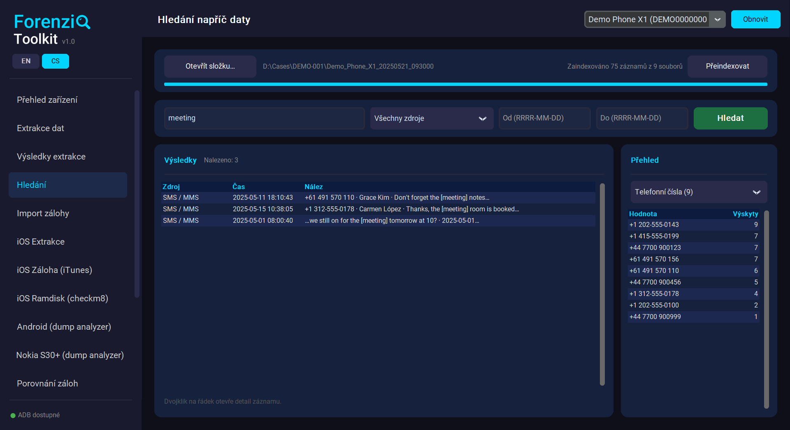

Prohledává **všechny zdroje jedné extrakce najednou** – zprávy, hovory, kontakty, historii prohlížeče,
soubory, WhatsApp, data z iOS, importované zálohy, … Data se indexují do `<výstupní složka>/_case/index.sqlite`.

**Otevření dat:** po extrakci, analýze Android dumpu nebo S30+ se složka do Hledání předá automaticky;
jinak použijte **Otevřít složku…**. Indexace běží na pozadí (ukazatel průběhu v liště) a je přírůstková –
znovu se zpracují jen změněné soubory. **Přeindexovat** vynutí úplné přestavění.

**Vyhledávací pole:**

| Zadáte | Výsledek |
|---|---|
| `schůzka` | záznamy se slovem začínajícím na „schůzka“ (hledání podle začátku slova) |
| `jan novak` | musí být obě slova (A ZÁROVEŇ) |
| `"sejdeme se u"` | přesná fráze v uvozovkách |
| `zlutoucky` | diakritika a velikost písmen nehrají roli – najde „Žluťoučký“; `strasse` najde „Straße“ |
| `+420 777 123 456`, `777123456` | telefonní číslo v **libovolném tvaru** – viz níže |
| `北京`, `พรุ่งนี้`, `서울` | podporovány jsou i jazyky bez mezer mezi slovy (čínština, japonština, korejština, thajština, …) |

Výsledky lze zúžit podle **zdroje** a **rozsahu dat** (`RRRR-MM-DD`). U každého výsledku je zdroj, čas
a úryvek se shodou v `[hranatých závorkách]`; **dvojklik** otevře celý záznam. Výsledky se načítají po 300
(**Načíst další**).

**Telefonní čísla – nezávisle na zemi.** Čísla se převádějí na mezinárodní tvar a shodují se, když je jedno
koncovkou druhého (aspoň 7 číslic). Proto `777 123 456` = `+420 777 123 456`, `07700 900123` =
`+44 7700 900123` a `0171 1234567` = `+49 171 1234567`, zatímco čísla z různých zemí se stejnou národní
částí (např. `+420…` a `+421…`) se nesloučí.

### 9.1 Přehled identifikátorů

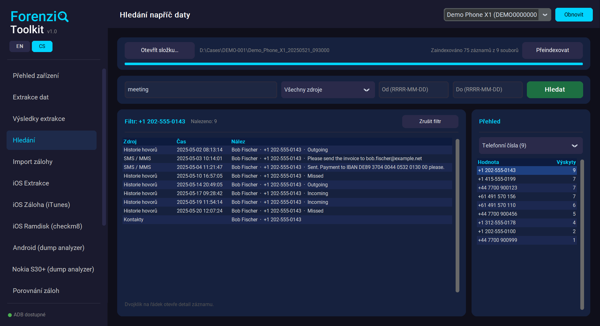

Panel **Přehled** vypisuje identifikátory nalezené v datech a počet záznamů, ve kterých se vyskytují:

| Druh | Poznámka |
|---|---|
| Telefonní čísla | různé tvary téhož čísla se sloučí |
| E-mailové adresy, Webové adresy | |
| IBAN (bankovní účty) | všechny země s IBAN, ověřené kontrolní číslice |
| Kryptoměnové adresy | Bitcoin (legacy + bech32), Ethereum |
| IMEI | ověřený kontrolní součet (Luhn) |
| Platební karty | ověřený prefix vydavatele a kontrolní součet (Luhn) |
| IP adresy | IPv4 |
| Rodná čísla (CZ/SK), SPZ (CZ) | **regionální** detektory – relevantní pro česká/slovenská data |

Kliknutím na položku zobrazíte všechny záznamy, které ji obsahují (**Zrušit filtr** vrátí textové hledání).
Kryptoadresy a SPZ se rozpoznávají podle tvaru textu – berte je jako nápovědu a ověřte je.

---

## 10. Import zálohy (zálohy výrobců Androidu)

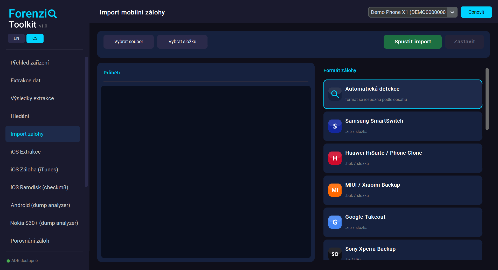

Importuje data ze záloh bez připojeného zařízení.

| Formát | Typický soubor |
|---|---|
| Automatická detekce | formát se rozpozná z obsahu |
| Samsung SmartSwitch | `.zip` / složka |
| Huawei HiSuite / Phone Clone | `.hbk` / složka |
| MIUI / Xiaomi Backup | `.bak` / složka |
| Google Takeout | `.zip` / složka |
| Sony Xperia Backup | `.bk` (ZIP) |
| OnePlus / OxygenOS, OPPO / realme (ColorOS), Vivo / iQOO (EasyShare), Motorola (Migrate), LG Backup | složky / archivy záloh výrobců |
| ADB Backup | `.ab` |

1. **Vybrat soubor** (archiv) nebo **Vybrat složku** (rozbalená záloha).
2. Ponechte *Automatickou detekci* nebo zvolte formát ručně.
3. Klikněte na **Spustit import** a zvolte výstupní složku.

Typicky importovaná data: kontakty, SMS, historie hovorů, Wi-Fi sítě, kalendář, historie prohlížeče,
poznámky a nainstalované aplikace (podle toho, co záloha obsahuje).

---

## 11. iOS Extrakce (živé zařízení)

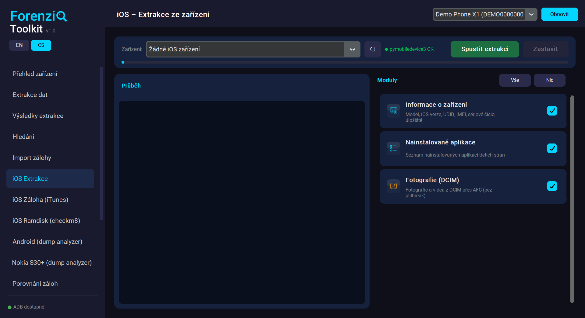

Vyžaduje volitelný balíček **pymobiledevice3** (stav je vidět v liště) a důvěryhodný, odemčený
iPhone/iPad připojený přes USB. Moduly: **Informace o zařízení** (model, verze iOS, UDID, IMEI, sériové
číslo, úložiště), **Nainstalované aplikace** a **Fotografie (DCIM)** přes AFC – bez jailbreaku.

---

## 12. iOS Záloha (iTunes / Finder) včetně šifrovaných

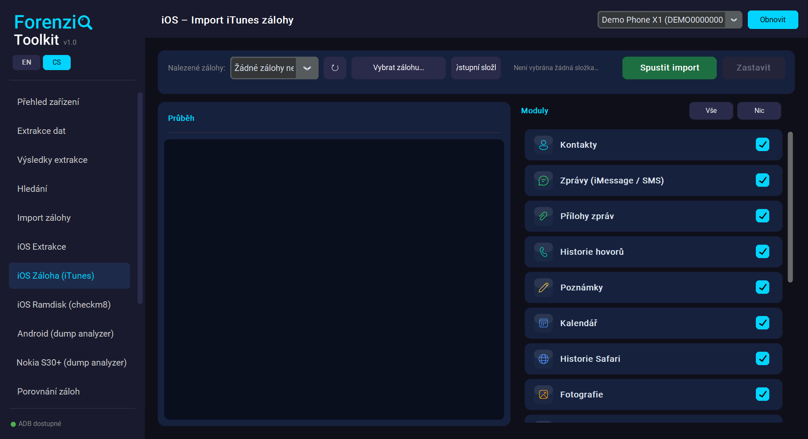

Zpracuje lokální zálohu iTunes/Finder. Zálohy ve výchozím umístění Apple se najdou automaticky
(**Nalezené zálohy**, ↻ pro nové hledání); jinou složku zálohy otevřete přes **Vybrat zálohu…**.

**Šifrované zálohy** jsou podporované: je-li vybraná záloha šifrovaná, objeví se pole pro heslo. Zadejte
heslo zálohy – záloha se průběžně dešifruje do dočasné složky, která se po importu smaže. Špatné heslo se
ohlásí a nic se nevytáhne. Šifrované zálohy obsahují více dat (např. WhatsApp, položky chráněné klíčenkou)
než nešifrované.

Moduly: Kontakty, Zprávy (iMessage / SMS), Přílohy zpráv, Historie hovorů, Poznámky, Kalendář, Historie
Safari, Fotografie, Fotky s GPS, Hlasová pošta, Wi-Fi sítě, Nainstalované aplikace, Využití aplikací,
WhatsApp zprávy, WhatsApp kontakty, Viber zprávy.

> Dešifrování bylo ověřeno na syntetických testovacích zálohách; než se na něj spolehnete v případu,
> ověřte výsledky na známé záloze.

---

## 13. iOS Ramdisk (checkm8)

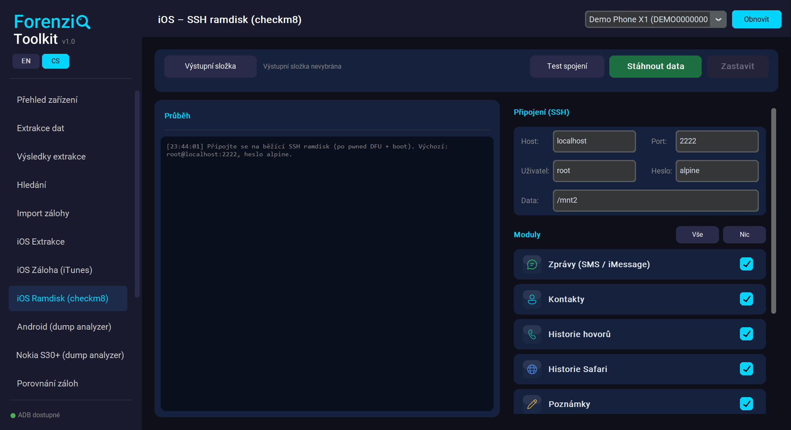

Získá data z iPhonu nabootovaného do **SSH ramdisku**. Zařízení je potřeba uvést do pwned DFU a ramdisk
nabootovat **externími nástroji** (checkm8 pro A5–A11; nástroje založené na usbliter8 pro A12/A13 –
typicky na macOS s dalším hardwarem). ForenziQ se jen připojí k běžícímu ramdisku přes SSH (výchozí
`root@localhost:2222`, heslo `alpine`, datový mountpoint `/mnt2`) – nejdřív použijte **Test spojení**.

Moduly: Zprávy (SMS / iMessage), Kontakty, Historie hovorů, Historie Safari, Poznámky, Účty,
Fotografie (DCIM), WhatsApp a Keychain (stáhne se **šifrovaný**, nedešifruje se). Každý stažený soubor se zahashuje (SHA-256).

> Vyžaduje volitelný balíček **paramiko**. U zamčeného zařízení (BFU) zůstává datový oddíl zašifrovaný.
> Modul zatím nebyl ověřen na reálném zařízení – mountpointy se mohou lišit.

---

## 14. Android (dump analyzer)

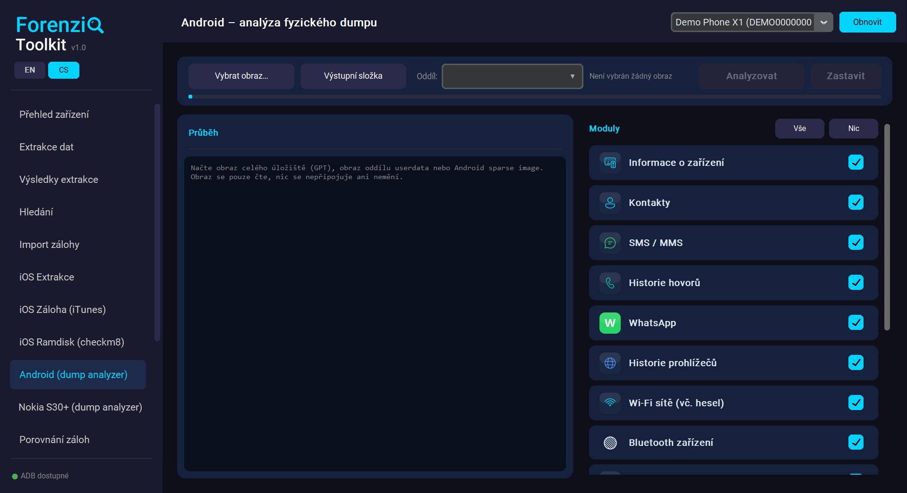

Analyzuje fyzický obraz úložiště Androidu **pouze pro čtení** (nic se nepřipojuje ani nemění): obraz celého
úložiště (GPT), obraz samotného oddílu `userdata` nebo Android **sparse** obraz.

1. **Vybrat obraz…**, pak zvolte **Oddíl** k analýze (u celého GPT obrazu oddíl userdata).
2. Zvolte **Výstupní složku**, vyberte moduly a klikněte na **Analyzovat**.

Moduly: Informace o zařízení, Kontakty, SMS / MMS, Historie hovorů, WhatsApp, Historie prohlížečů,
Wi-Fi sítě (vč. hesel), Bluetooth zařízení, Účty, Nainstalované aplikace, Interní úložiště (fotky,
soubory). Výsledky se otevřou ve Výsledcích / Časové ose / Mapě / Hledání stejně jako u živé extrakce.

> Podporovaný souborový systém: **ext4**. F2FS a šifrovaná uživatelská data (FBE/FDE) se rozpoznají
> a ohlásí jako nepodporovaná. Testováno na syntetických obrazech – před použitím v případu ověřte na
> známém dumpu.

---

## 15. Nokia S30+ (dump analyzer)

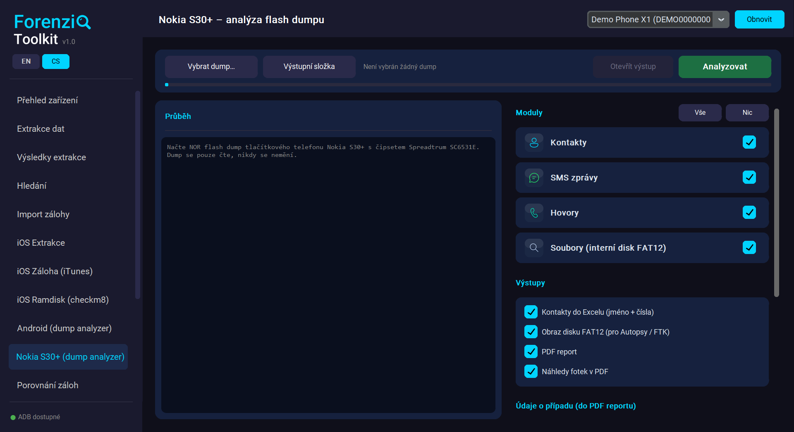

Analyzuje NOR flash dump tlačítkového telefonu Nokia S30+ s čipem **Spreadtrum SC6531E** (dump se jen
čte). Moduly: Kontakty, SMS zprávy, Hovory, Soubory (interní disk FAT12) – včetně obnovy smazaných
záznamů, kde je to možné.

**Výstupy:** kontakty do Excelu (jméno + čísla), obraz disku FAT12 (pro Autopsy / FTK), PDF report
(volitelně s náhledy fotek). Volitelné údaje o případu se vytisknou do PDF reportu. Výsledky se zobrazí
také na Časové ose a v Hledání.

---

## 16. Porovnání záloh

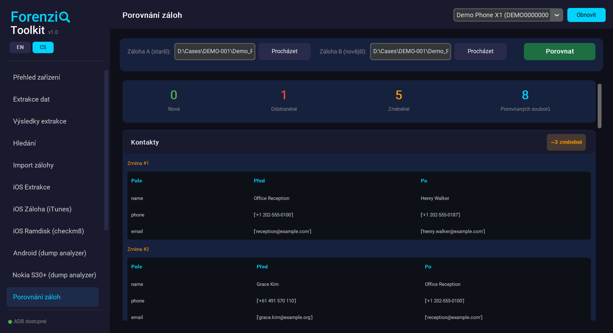

Porovná dvě výstupní složky téhož zařízení (např. před incidentem a po něm).

1. **Záloha A (starší)** → Procházet, **Záloha B (novější)** → Procházet.
2. Klikněte na **Porovnat**.

Souhrn ukazuje počet **nových**, **odstraněných** a **změněných** záznamů a počet porovnaných souborů.
Každý typ dat má vlastní kartu; změny se zobrazují po polích (*Před → Po*).

---

## 17. Časová osa

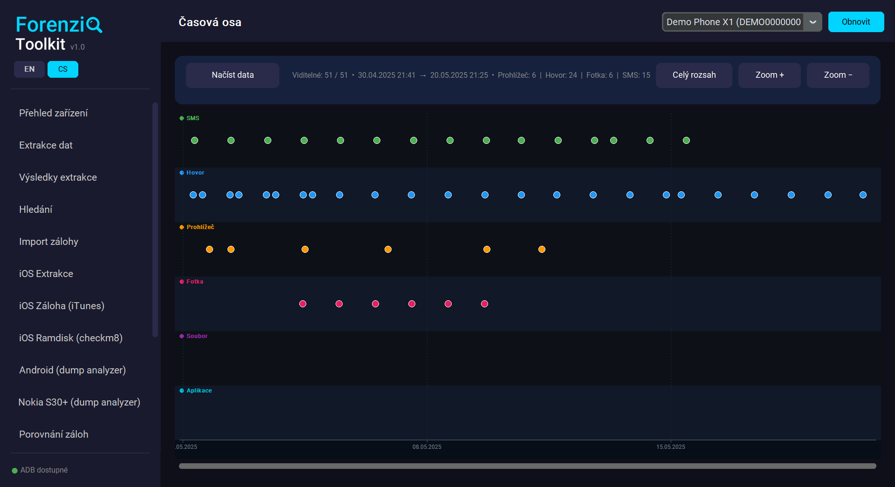

Zobrazuje SMS, hovory, historii prohlížeče, fotky, soubory a události aplikací na časové ose, každý zdroj
ve vlastním pruhu.

| Akce | Výsledek |
|---|---|
| **Načíst data** | výběr výstupní složky (po extrakci se načte automaticky) |
| Tažení **levým tlačítkem myši** | posun po časové ose |
| **Kolečko myši** | přiblížení / oddálení v místě kurzoru |
| **Pravé tlačítko**, **Celý rozsah** | zobrazí celé časové období |
| **Zoom + / Zoom −** | tlačítka přiblížení |
| **Klik na tečku** | detail události (zdroj, datum, čas, všechna pole) |
| Zaškrtávátka zdrojů | zobrazení / skrytí zdrojů |

Blízké události se slučují do větší tečky s počtem – přiblížením je rozdělíte.

---

## 18. Mapa GPS lokací

Zobrazuje místa pořízení fotek s GPS souřadnicemi na mapě OpenStreetMap se seznamem fotek a panelem
detailu (název souboru, datum pořízení, souřadnice, nadmořská výška, fotoaparát, rozlišení, velikost).

> ⚠ Mapa **stahuje mapové dlaždice z internetu** (OpenStreetMap). Z požadavků na dlaždice je pro server
> poznat zobrazovanou oblast. Pokud případ vyžaduje zcela offline pracoviště, Mapu neotevírejte.
> Mapa zobrazí nejvýše 300 značek, seznam nejvýše 250 fotek.

---

## 19. Obcházení zámku

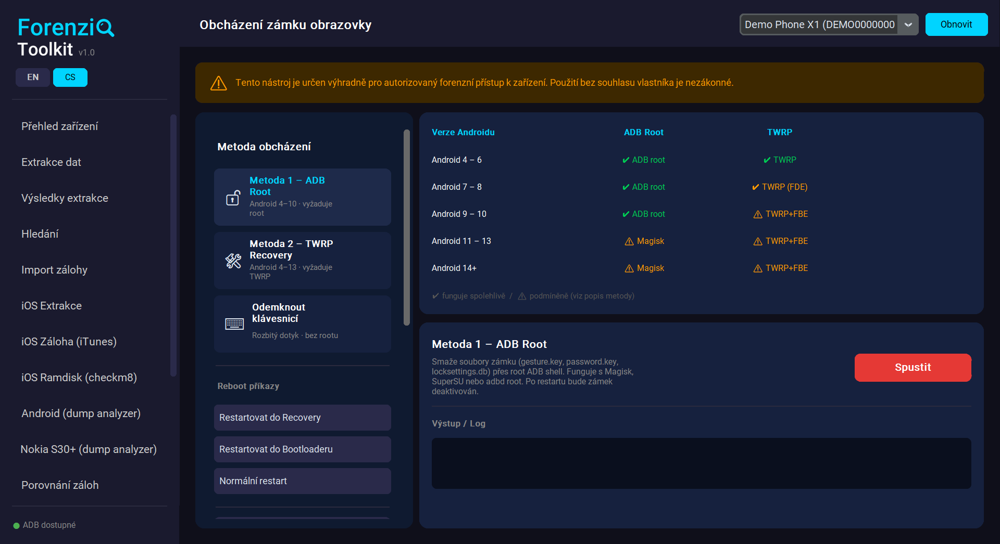

> ⚠ Pouze pro zařízení, ke kterým máte zákonné oprávnění.

| Metoda | Požadavky | Popis |
|---|---|---|
| **Metoda 1 – ADB Root** | Android 4–10, root | smaže soubory zámku (`gesture.key`, `password.key`, `locksettings.db`) |
| **Metoda 2 – TWRP Recovery** | Android 4–13, TWRP | připojí `/data` v TWRP a smaže soubory zámku; zařízení s FBE potřebují TWRP s podporou dešifrování |
| **Odemknout klávesnicí** | rozbitý dotykový displej, bez rootu | zadá **známý** PIN, heslo nebo gesto přes ADB – nejde o prolomení zámku |
| **FRP-1 – ADB Nastavení** | Android 5–6 | úprava nastavení přes ADB |
| **FRP-2 – TWRP wipe FRP** | Android 5–13, TWRP | vynuluje oddíl FRP |
| **FRP-3 – Fastboot erase** | odemčený bootloader | `fastboot erase frp` |
| **FRP-4 – Root: smazat účet** | Android 5–10, root | odstraní účet Google z `accounts.db` |

Tabulka kompatibility ukazuje, která metoda je pro kterou verzi Androidu spolehlivá. **Reboot příkazy**
(Recovery, Bootloader, normální restart) jsou v levém panelu.

---

## 20. Nastavení (branding reportů)

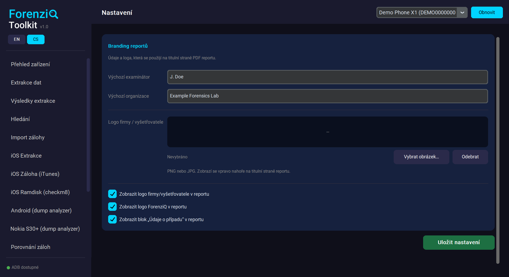

- **Výchozí examinátor** a **Výchozí organizace** – předvyplní se do údajů o případu v reportech.
- **Logo firmy / vyšetřovatele** (PNG nebo JPG) – vytiskne se vpravo nahoře na titulní straně PDF.
- Přepínače: zobrazit logo firmy, logo ForenziQ a blok *Údaje o případu* v reportu.

Nastavení se ukládá do `%USERPROFILE%\.forenziq\settings.json`.

---

## 21. Bezdrátové připojení (Wi-Fi ADB)

1. Nejdřív připojte zařízení přes USB.
2. V postranním panelu otevřete **Wi-Fi připojení** a klikněte na **Aktivovat TCP/IP** (port 5555).
3. Klikněte na **Zjistit IP** (nebo IP adresu zařízení zadejte ručně).
4. Klikněte na **Připojit přes Wi-Fi** – USB kabel pak můžete odpojit.

Počítač a zařízení musí být ve stejné síti.

---

## 22. Doporučený postup

```
1. Příprava          – oprávnění, ladění USB / záloha / dump připravené
2. Identifikace      – Přehled zařízení: zapsat model, IMEI, sériové číslo
3. Akvizice          – Extrakce dat, Import zálohy, iOS, Android dump nebo S30+
4. Integrita         – Výsledky → Manifest důkazů (hned po akvizici)
5. Analýza           – Hledání, Časová osa, Mapa, Porovnání
6. Reporty           – Výsledky → HTML / PDF / Excel
7. Závěrečná kontrola – Výsledky → Ověřit integritu
```

---

## 23. Nakládání s daty a soukromí

- Veškerá akvizice i analýza probíhá **lokálně**. ForenziQ nemá telemetrii, kontrolu aktualizací ani
  cloudové funkce.
- Jediný modul, který se připojuje k internetu, je **Mapa** (dlaždice OpenStreetMap).
- Extrahovaná data, reporty, index hledání (`_case/`) i manifest důkazů se zapisují jen do výstupní
  složky, kterou zvolíte. Dočasné soubory při importu šifrované iOS zálohy se po importu smažou.

---

## 24. Řešení problémů

| Problém | Řešení |
|---|---|
| Zařízení není detekováno | zapněte ladění USB, potvrďte dotaz v telefonu, použijte datový kabel, nainstalujte USB ovladač, spusťte `adb kill-server` a **Obnovit** |
| Extrakce selže nebo vrátí málo dat | odemkněte zařízení, potvrďte dotazy na oprávnění, zkontrolujte volné místo na disku |
| Moduly *Smazaná data* / WhatsApp nic nevrátí | vyžadují root |
| iOS zařízení se nenajde | nainstalujte pymobiledevice3, odemkněte zařízení a klepněte na **Důvěřovat** |
| iOS záloha – špatné heslo | jde o heslo zálohy nastavené v iTunes/Finderu, ne o kód zařízení |
| Android dump – „nepodporováno“ | datový oddíl je F2FS nebo šifrovaný; podporován je jen ext4 |
| Mapa je prázdná | fotky nemají GPS údaje, nebo chybí připojení k internetu |
| Časová osa / Hledání je prázdné | otevřete výstupní složku extrakce (musí obsahovat `.json` soubory modulů) |
| Hledání čísla nic nenajde | zadejte aspoň 7 číslic; na formátu nezáleží |

---

*ForenziQ v1.0 · Uživatelská příručka (CS)*
