# ForenziQ – User Guide

> **Version 1.0 · For authorised forensic analysis only**
>
> 🇨🇿 Česká verze: [MANUAL_CS.md](MANUAL_CS.md)

All screenshots in this guide were taken with a **fictitious demo case** (device "Demo Phone X1",
reserved fictional phone numbers, `example.com` addresses). They contain no real data.

---

## Contents

1. [Introduction and legal notice](#1-introduction-and-legal-notice)
2. [System requirements](#2-system-requirements)
3. [Installation and launch](#3-installation-and-launch)
4. [Preparing an Android device](#4-preparing-an-android-device)
5. [Interface overview](#5-interface-overview)
6. [Device Overview](#6-device-overview)
7. [Data Extraction (Android over ADB)](#7-data-extraction-android-over-adb)
8. [Extraction Results, reports and evidence integrity](#8-extraction-results-reports-and-evidence-integrity)
9. [Search across data](#9-search-across-data)
10. [Backup Import (Android vendor backups)](#10-backup-import-android-vendor-backups)
11. [iOS Extraction (live device)](#11-ios-extraction-live-device)
12. [iOS Backup (iTunes / Finder), incl. encrypted backups](#12-ios-backup-itunes--finder-incl-encrypted-backups)
13. [iOS Ramdisk (checkm8)](#13-ios-ramdisk-checkm8)
14. [Android dump analyzer](#14-android-dump-analyzer)
15. [Nokia S30+ dump analyzer](#15-nokia-s30-dump-analyzer)
16. [Backup Comparison](#16-backup-comparison)
17. [Timeline](#17-timeline)
18. [GPS Location Map](#18-gps-location-map)
19. [Screen Lock Bypass](#19-screen-lock-bypass)
20. [Settings (report branding)](#20-settings-report-branding)
21. [Wireless connection (Wi-Fi ADB)](#21-wireless-connection-wi-fi-adb)
22. [Recommended workflow](#22-recommended-workflow)
23. [Data handling and privacy](#23-data-handling-and-privacy)
24. [Troubleshooting](#24-troubleshooting)

---

## 1. Introduction and legal notice

**ForenziQ** is a desktop toolkit for acquiring and analysing data from mobile devices:

- live extraction from Android devices over ADB (USB or Wi-Fi),
- analysis of Android physical dumps (raw / GPT / sparse images, ext4 and F2FS),
- import of Android vendor backups (Samsung, Huawei, Xiaomi, Google, …),
- iOS: live extraction, iTunes/Finder backups (including **encrypted** backups) and SSH-ramdisk acquisition,
- Nokia S30+ feature phones (Spreadtrum SC6531E flash dumps),
- analysis: full-text **search** across all sources, timeline, GPS map, comparison of two extractions,
- reports (HTML, PDF, Excel) and an **evidence manifest** (MD5 + SHA-256) for chain of custody.

The user interface is available in **English** (default) and **Czech**.

### ⚠ Legal notice

> This software is intended **exclusively for lawful forensic analysis** of devices for which you have
> **explicit authorisation** (your own device, the owner's consent, a court order or an equivalent legal
> basis). Using it without such authorisation is illegal and may constitute a criminal offence. The author
> accepts **no responsibility** for unlawful use. By running the software you agree to these terms.

---

## 2. System requirements

| Requirement | Minimum |
|---|---|
| Operating system | Windows 10 / 11 (64-bit) |
| Python (when running from source) | 3.11 or later |
| RAM | 4 GB (8 GB recommended) |
| Disk space | 500 MB + space for extracted data |
| Internet | Not required. Only the **Map** downloads map tiles from OpenStreetMap. |

**Python packages** (`requirements.txt`):

| Package | Purpose |
|---|---|
| customtkinter | User interface |
| Pillow | Images, EXIF metadata, thumbnails |
| reportlab | PDF reports |
| openpyxl | Excel export |
| deepdiff | Backup comparison |
| tkintermapview | GPS map |
| cryptography | Decrypting encrypted iOS backups |
| pymobiledevice3 *(optional)* | Live iOS extraction |
| paramiko *(optional)* | iOS SSH ramdisk acquisition |

---

## 3. Installation and launch

### 3.1 Standalone `.exe` (no Python needed)

If you received `ForenziQ.exe`, just run it. Everything – including ADB – is bundled inside the single file.

### 3.2 Running from source

```bash
pip install -r requirements.txt
python main.py
```

or double-click `run.bat` (uses the Python launcher `py`, or `python` from PATH).

### 3.3 ADB (Android Debug Bridge)

ADB is **not part of the source repository** (it is Google software with its own license). When running
from source, download **SDK Platform-Tools for Windows** from Google (https://developer.android.com/tools/releases/platform-tools) and either

- extract the contents of the `platform-tools` folder into an `adb/` folder in the project
  (so that `adb/adb.exe` exists) – ForenziQ uses it automatically, or
- add the `platform-tools` folder to the system `PATH`.

The ADB status is shown at the bottom of the sidebar. The standalone `ForenziQ.exe` already contains ADB.

### 3.4 Building the `.exe` yourself

```bash
pip install pyinstaller
python -m PyInstaller ForenziQ.spec --noconfirm --clean
```

The result is `dist/ForenziQ.exe` (a single file, ~60 MB). If the `adb/` folder exists at build time,
ADB is bundled into the `.exe`.

---

## 4. Preparing an Android device

1. Open **Settings → About phone** and tap **Build number** 7 times (unlocks Developer options).
2. In **Settings → Developer options** enable **USB debugging**.
3. Connect the phone with a data-capable USB cable.
4. Unlock the phone and confirm the **Allow USB debugging** prompt.

> **Tips:** Use a data cable (not charge-only), try another USB port, set the USB mode to *File transfer*,
> and install the manufacturer's USB driver if the device does not appear.

---

## 5. Interface overview

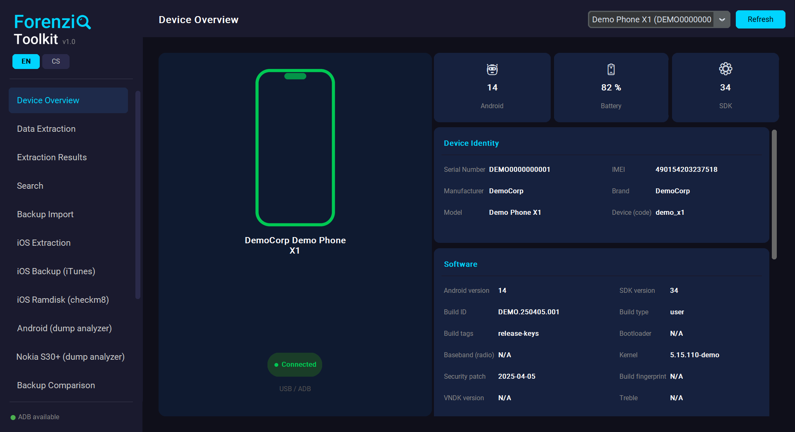

- **Sidebar (left)** – navigation between modules, language switch **EN / CS** (switches instantly,
  no restart), **Wi-Fi connection** and the ADB status indicator at the bottom.
- **Top bar** – title of the current module, the list of connected Android devices and **Refresh**.
- **Working area** – the current module. Action panels share the same layout: a toolbar at the top
  (source → status → main action), **Progress** log on the left and **Modules** on the right.

---

## 6. Device Overview

Shows details of the selected Android device: manufacturer, model, Android version, SDK, battery, serial
number, IMEI, build information, security patch, kernel, encryption, SELinux, root status, RAM, storage,
screen and more. The values are read over ADB when the device is selected.

---

## 7. Data Extraction (Android over ADB)

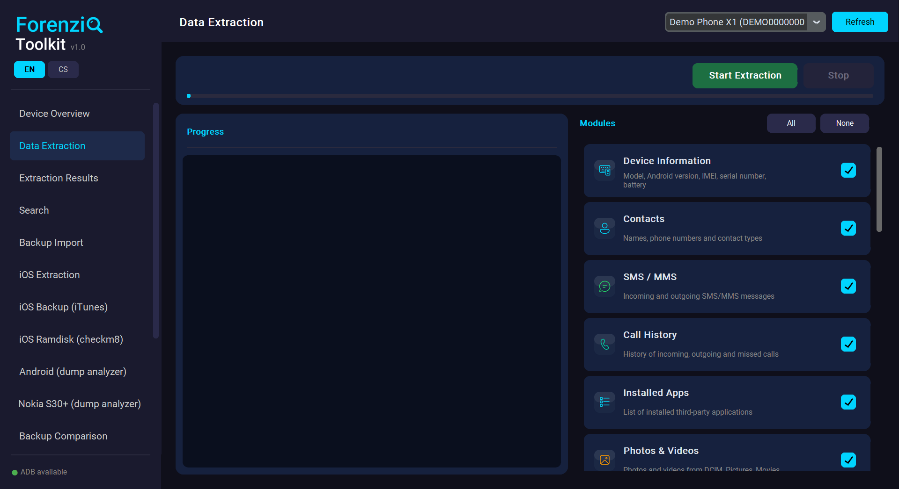

1. Select the modules on the right (**All / None** for quick selection).
2. Click **Start Extraction** and choose the parent output folder. A sub-folder named
   `<model>_<date>_<time>` is created.
3. Follow the progress in the log; **Stop** interrupts the extraction.
4. When finished, the **Results**, **Timeline**, **Map** and **Search** modules receive the data automatically.

| Module | Data |
|---|---|
| Device Information | Model, Android version, IMEI, serial number, battery |
| Contacts | Names, phone numbers, contact types |
| SMS / MMS | Incoming and outgoing messages |
| Call History | Incoming, outgoing and missed calls |
| Installed Apps | Third-party applications |
| Photos & Videos | Media from DCIM, Pictures, Movies |
| Documents | PDF, Office and text documents |
| Wi-Fi Networks | Saved networks |
| Accounts | Accounts configured on the device |
| Browser History | Visited pages |
| User Data (with structure) | Complete `/sdcard` with the folder structure preserved |
| File Analysis (EXIF & metadata) | EXIF, camera, GPS coordinates of photos |
| File Hashes (MD5, SHA-256) | Checksums of the extracted files |
| Deleted Data (root) | Recovery of deleted records *(root required)* |
| WhatsApp / Viber (root) | Messenger databases *(root required)* |
| ADB App Backup, Root Backup `/data/data`, App Data (Content Providers), App Usage Statistics, Termux Agent | Extended acquisition methods |

> **Tip:** Run *File Hashes* last – it hashes the files extracted by the previous modules.

---

## 8. Extraction Results, reports and evidence integrity

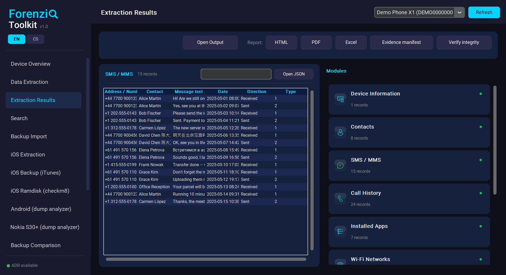

- **Modules** (right) – one card per module with the number of records. Click a card to view its data.
- **Data view** (left) – table (or key/value list) with a quick filter field; click a column header to sort,
  **double-click a row** to open the record detail. **Open JSON** opens the source file. Photo modules show
  a thumbnail gallery.
- **Open Output** opens the output folder.

### 8.1 Reports

| Button | Output |
|---|---|
| **HTML** | Interactive report for a web browser |
| **PDF** | Professional report: cover page (case details, examiner, logos), clickable table of contents, PDF bookmarks, page header/footer; the text is searchable |
| **Excel** | Spreadsheet export for further analysis |

The PDF cover page uses the branding from **Settings** (section 20).

### 8.2 Evidence manifest and integrity check

- **Evidence manifest** – hashes every file in the output folder (MD5 + SHA-256) and stores the hashes
  together with optional case details (case number, examiner, organisation, evidence ID, note) in
  `evidence_manifest.json` / `.txt`, including an aggregate SHA-256.
- **Verify integrity** – re-hashes the folder and reports unchanged, **modified**, **missing** and **added** files.

> The `_case/` sub-folder (search index, analyst work products) is deliberately excluded from the manifest,
> so working with the data never breaks the integrity check.

---

## 9. Search across data

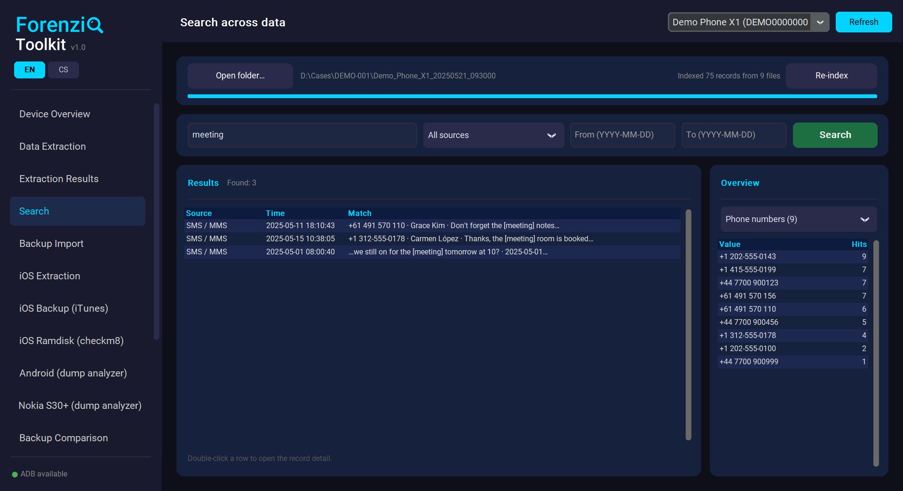

Searches **all sources of one extraction at once** – messages, calls, contacts, browser history, files,
WhatsApp, iOS data, imported backups, … The data is indexed into `<output folder>/_case/index.sqlite`.

**Opening data:** after an extraction, Android dump or S30+ analysis the folder is passed to Search
automatically; otherwise use **Open folder…**. Indexing runs in the background (progress bar in the
toolbar). It is incremental – only changed files are re-indexed. **Re-index** forces a full rebuild.

**Search field:**

| You type | Result |
|---|---|
| `meeting` | records containing a word starting with "meeting" (prefix search) |
| `jan novak` | both words must be present (AND) |
| `"see you at"` | exact phrase in quotes |
| `zlutoucky` | accents and case are ignored – finds "Žluťoučký"; `strasse` finds "Straße" |
| `+44 7700 900123`, `07700 900123` | a phone number in **any format** – see below |
| `北京`, `พรุ่งนี้`, `서울` | languages without spaces between words (Chinese, Japanese, Korean, Thai, …) are supported |

Narrow the results by **source** and by a **date range** (`YYYY-MM-DD`). Each result shows the source,
time and a snippet with the match in `[brackets]`; **double-click** opens the full record. Results are
loaded in pages of 300 (**Load more**).

**Phone numbers – independent of country.** Numbers are normalised to the international form and match
when one is the ending of the other (at least 7 digits). Therefore `07700 900123` = `+44 7700 900123`,
`0171 1234567` = `+49 171 1234567` and `777 123 456` = `+420 777 123 456`, while numbers from different
countries with the same national part (e.g. `+420…` vs `+421…`) are not merged.

### 9.1 Overview of identifiers

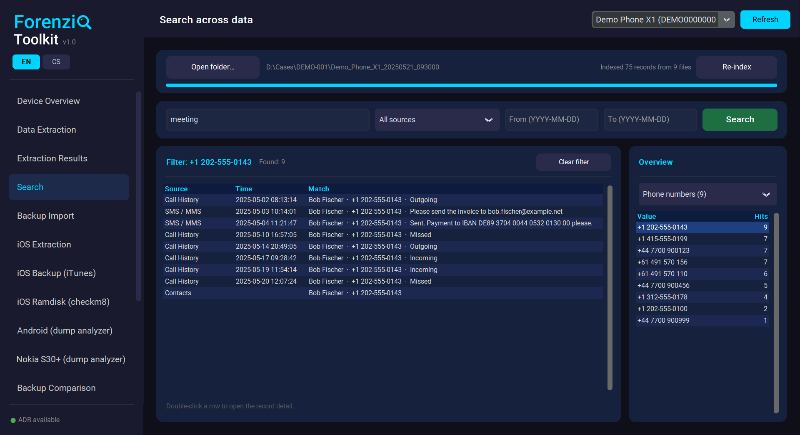

The **Overview** panel lists identifiers found in the data, with the number of records each appears in:

| Type | Notes |
|---|---|
| Phone numbers | different formats of the same number are merged |
| E-mail addresses, Web addresses | |
| IBAN (bank accounts) | all IBAN countries, check digits verified |
| Crypto addresses | Bitcoin (legacy + bech32), Ethereum |
| IMEI | Luhn checksum verified |
| Payment cards | issuer prefix + Luhn checksum verified |
| IP addresses | IPv4 |
| Birth numbers (CZ/SK), Licence plates (CZ) | **regional** detectors – relevant for Czech/Slovak data |

Clicking an item shows every record that contains it (**Clear filter** returns to the text search).
Detection of crypto addresses and licence plates is based on patterns – treat them as hints and verify.

### 9.2 Tags, keyword lists and the tagged report

**Tags.** Select records in the results (Ctrl/Shift + click), choose a tag in the tag bar and click
**Tag selected** – or **Tag all** to tag every record of the current search. Default tags are *Evidence*,
*Suspicious* and *To review*; create your own with **＋ New tag…**. **Remove** takes the chosen tag off the
selected records, **Note** adds a comment to tagged records. **Tagged items** lists everything tagged in
the case; the *Tags* column shows the tags of every result.

You can also tag outside Search: in **Results** select table rows and click **🏷 Tag ▾** (or right-click);
in the **Timeline** open an event and use **🏷 Tag ▾** in its detail. A ticked tag means all selected
records already have it – clicking it removes it. Tags are shared by the whole case, so they also appear
in Search and in the tagged report. Tagged rows in Results are highlighted in orange.

**Keyword lists.** **Keyword lists** opens a dialog where you create, edit or import (`.txt`) lists of
terms – one per line (words, phrases, phone numbers, e-mails…), lines starting with `#` are comments.
Lists are stored outside the case (`~/.forenziq/keyword_lists/`) and can be reused and shared.
**Search list** runs all terms at once with the same rules as the search field (accents, number formats…):
the results show which terms hit each record (🔑) and the right panel shows the number of hits per term –
click a term to see only its records. **Tag all** then tags all hits.

**Report of tagged items.** **Tagged report** creates `report_tagged.pdf` and `report_tagged.html` in the
output folder with the same layout as the main report. Each record carries its tags, note, who tagged it
and when, and the SHA-256 of its source file at tagging time.

**Audit trail.** Every tagging action, note, keyword list run and tagged report is appended to
`_case/audit.jsonl` (time, examiner from Settings, action). Tags are stored in `_case/tags.sqlite`;
the `_case/` folder and generated reports are analyst work product and are not part of the evidence
manifest.

### 9.3 ALEAPP / iLEAPP

[ALEAPP](https://github.com/abrignoni/ALEAPP) (Android) and [iLEAPP](https://github.com/abrignoni/iLEAPP)
(iOS) by Alexis Brignoni are open-source artifact parsers (MIT licence) with hundreds of app parsers.
ForenziQ does **not** bundle them: download the portable `aleapp.exe` / `ileapp.exe` from their GitHub
Releases (**Download** button in the panel) or point ForenziQ at `aleapp.py` / `ileapp.py` of a source
checkout (run with `py` / `python` from PATH, which needs the tool's requirements installed). The path is
remembered in the settings.

1. Open **ALEAPP / iLEAPP**, pick the tool and its path.
2. Pick the input: a folder with device files (e.g. `user_data_tree`), an archive `.tar` / `.tar.gz` /
   `.zip` (e.g. `root_backup.tar.gz` from the root backup) or, for iLEAPP, an iTunes backup folder.
   Inputs found in the current case are offered as buttons. The input type (`-t`) is detected and can be
   changed.
3. Check the case folder (the current results folder by default) and click **Run**.

The tool writes its full report into `<case>/_leapp/ALEAPP_<time>/`. ForenziQ then imports it (from
LAVA `_lava_artifacts.db`, or `_TSV Exports` for older versions) into `aleapp.json` / `ileapp.json` in the
case folder – one section per artifact, times in UTC. These records are indexed, so they can be searched,
tagged and put into the tagged report like any other data. **Load existing report…** imports a report
created earlier outside ForenziQ. ALEAPP/iLEAPP exit with code 0 even when processing fails, so ForenziQ
reads the result from their log. For an encrypted iTunes backup iLEAPP needs the backup password; it
writes the password into its log, so ForenziQ masks it in the report when the run ends. The `_leapp/`
folder and the imported JSON are analyst work product and are not part of the evidence manifest.

---

## 10. Backup Import (Android vendor backups)

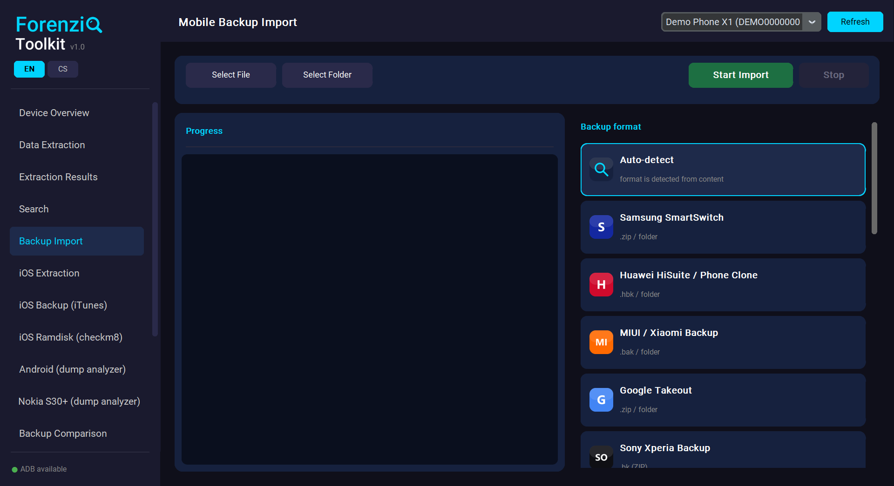

Imports data from backups without a connected device.

| Format | Typical file |
|---|---|
| Auto-detect | format is detected from the content |
| Samsung SmartSwitch | `.zip` / folder |
| Huawei HiSuite / Phone Clone | `.hbk` / folder |
| MIUI / Xiaomi Backup | `.bak` / folder |
| Google Takeout | `.zip` / folder |
| Sony Xperia Backup | `.bk` (ZIP) |
| OnePlus / OxygenOS, OPPO / realme (ColorOS), Vivo / iQOO (EasyShare), Motorola (Migrate), LG Backup | vendor backup folders / archives |
| ADB Backup | `.ab` |

1. **Select File** (archive) or **Select Folder** (unpacked backup).
2. Keep *Auto-detect* or choose the format manually.
3. If the backup is **encrypted** (ADB `.ab` or Xiaomi MIUI `.bak` with a password), a password field
   appears next to the file name – enter the backup password.
4. Click **Start Import**. The output folder is created automatically in `Documents`
   (`ForenziQ_Import_<backup name>_<date>_<time>`).

Typical imported data: contacts, SMS, call logs, Wi-Fi networks, calendar, browser history, notes and
installed apps (depending on what the backup contains).

**What is read from which backup:**

| Backup | Support |
|---|---|
| ADB backup `.ab` | ✅ compressed / uncompressed, **encrypted (AES-256) with the backup password** |
| Xiaomi MIUI `.bak` / AllBackup folder | ✅ including encrypted backups (password) |
| Google Takeout | ✅ contacts (vCard), calendar (iCal), Chrome history and bookmarks, Keep notes. Takeout does not contain SMS or call logs. |
| Samsung Smart Switch (PC / external storage backup, folder or `.zip`) | ✅ **decrypted** (backups without a password): contacts, call log, SMS/MMS/RCS (Google Messages), Wi-Fi (incl. passwords), installed apps, Samsung Internet history and bookmarks, photos and videos. The readable decrypted copy is kept in `smartswitch_decrypted/` of the output folder; device details and statistics are in `import_summary.json`. Backups protected with a **password / PIN are not supported yet**, Samsung Notes are only decrypted, not parsed. Tested on synthetic backups built by the documented format. |
| Huawei HiSuite / Phone Clone | ⚠️ the format is recognised, but current versions **encrypt** the data – decryption is not supported yet; only unencrypted files (e.g. photos) are imported |
| OPPO/realme, Vivo, Motorola, LG, Sony, OnePlus | ⚠️ the format is recognised; data is found only if the backup contains standard unencrypted Android files (contacts2.db, mmssms.db, vCard, …) |

Archives from backups are extracted safely – entries that try to write outside the extraction folder
(`../`, absolute paths, links) are skipped.

---

## 11. iOS Extraction (live device)

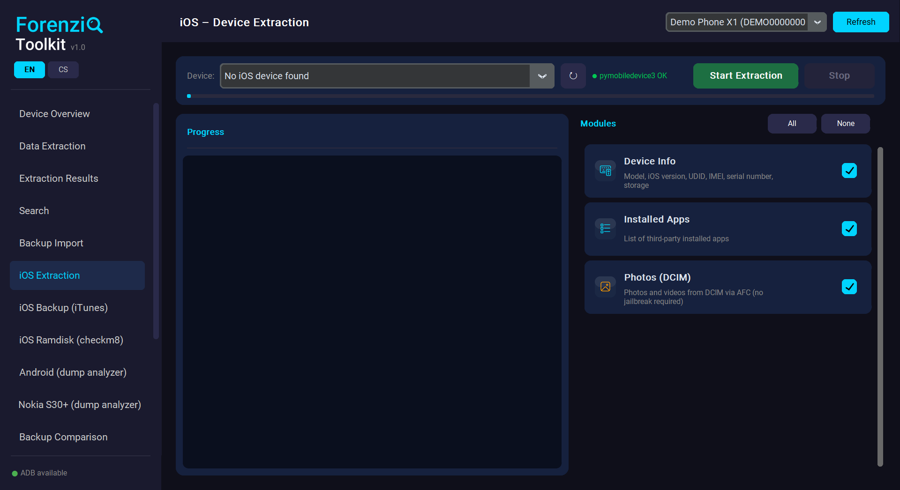

Requires the optional package **pymobiledevice3** (the status is shown in the toolbar) and a trusted,
unlocked iPhone/iPad connected via USB. Modules: **Device Info** (model, iOS version, UDID, IMEI, serial
number, storage), **Installed Apps** and **Photos (DCIM)** via AFC – no jailbreak required.

---

## 12. iOS Backup (iTunes / Finder), incl. encrypted backups

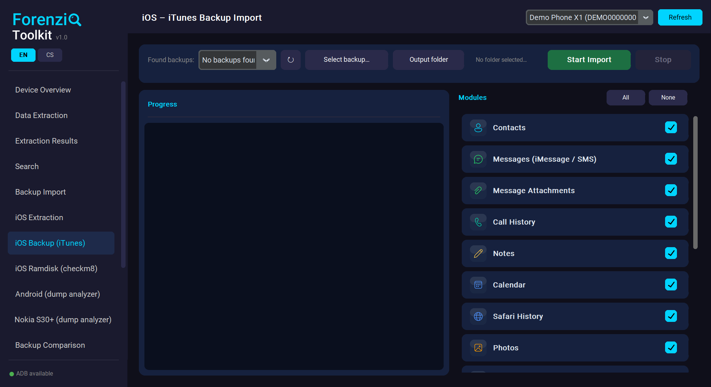

Parses a local iTunes/Finder backup. Backups in the default Apple location are found automatically
(**Found backups**, ↻ to rescan); any other backup folder can be opened with **Select backup…**.

**Encrypted backups** are supported: when the selected backup is encrypted, a password field appears.
Enter the backup password – the backup is decrypted on the fly into a temporary folder that is deleted
afterwards. A wrong password is reported and nothing is extracted. Encrypted backups contain more data
(e.g. WhatsApp, keychain-protected items) than unencrypted ones.

Modules: Contacts, Messages (iMessage / SMS), Message Attachments, Call History, Notes, Calendar,
Safari History, Photos, Photos with GPS, Voicemail, Wi-Fi Networks, Installed Apps, App Usage,
WhatsApp Messages, WhatsApp Contacts, Viber Messages.

> Decryption has been verified with synthetic test backups; verify the results against a known backup
> before relying on them in a case.

---

## 13. iOS Ramdisk (checkm8)

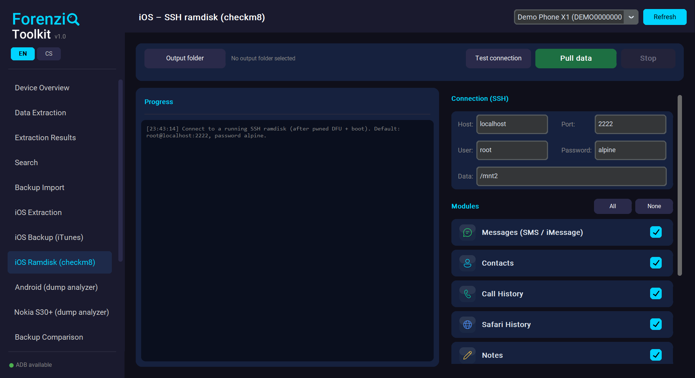

Acquires data from an iPhone booted into an **SSH ramdisk**. The device has to be put into pwned DFU and
the ramdisk booted with **external tools** (checkm8 for A5–A11; usbliter8-based tools for A12/A13 –
typically on macOS with additional hardware). ForenziQ only connects to the running ramdisk over SSH
(default `root@localhost:2222`, password `alpine`, data mount `/mnt2`) – use **Test connection** first.

Modules: Messages, Contacts, Call History, Safari History, Notes, Accounts, Photos (DCIM), WhatsApp and
the Keychain (downloaded **encrypted**, not decrypted). Every pulled file is hashed (SHA-256).

> Requires the optional package **paramiko**. A locked device (BFU) keeps the data partition encrypted.
> This module has not yet been validated against a real device – mount points may differ.

---

## 14. Android dump analyzer

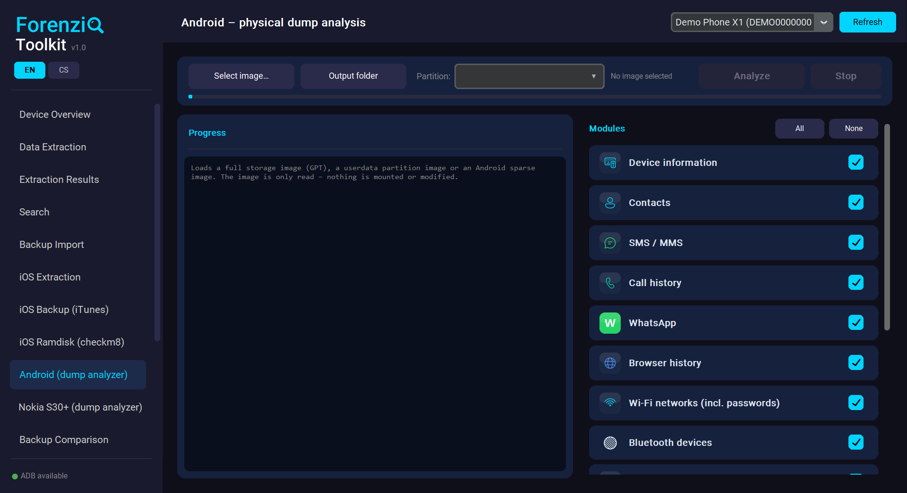

Analyses a physical image of Android storage **read-only** (nothing is mounted or modified):
a full storage image (GPT), a single `userdata` partition image, or an Android **sparse** image.

1. **Select image…**, then pick the **Partition** to analyse (for a full GPT image choose the userdata partition).
2. Choose the **Output folder**, select modules and click **Analyze**.

Modules: Device information, Contacts, SMS / MMS, Call history, WhatsApp, Browser history, Wi-Fi networks
(incl. passwords), Bluetooth devices, Accounts, Installed apps, Internal storage (photos, files).
Results open in Results / Timeline / Map / Search like a live extraction.

> Supported file systems: **ext4** and **F2FS**. Encrypted (FBE/FDE) user data is detected and reported as
> unsupported; F2FS-compressed files are skipped. Tested on synthetic images – verify on a known dump before use in a case.

---

## 15. Nokia S30+ dump analyzer

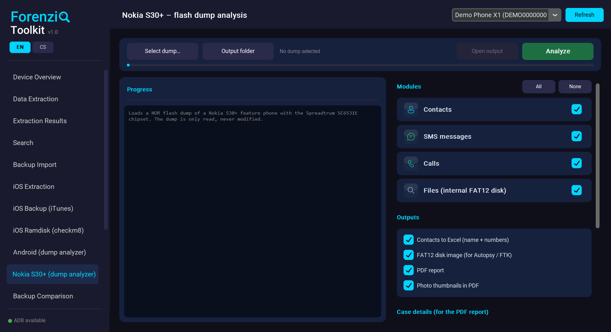

Analyses a NOR flash dump of a Nokia S30+ feature phone with the **Spreadtrum SC6531E** chipset
(the dump is only read). Modules: Contacts, SMS messages, Calls, Files (internal FAT12 disk) – including
recovery of deleted records where possible.

**Outputs:** contacts to Excel (name + numbers), a FAT12 disk image (for Autopsy / FTK), a PDF report
(optionally with photo thumbnails). Optional case details are printed in the PDF report. The results are
also shown on the Timeline and in Search.

---

## 16. Backup Comparison

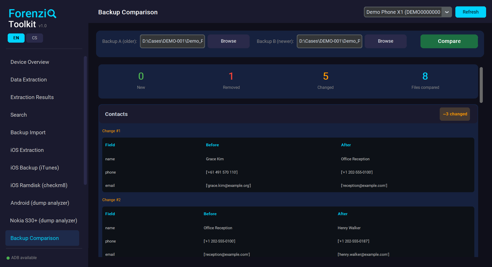

Compares two output folders of the same device (e.g. before and after an incident).

1. **Backup A (older)** → Browse, **Backup B (newer)** → Browse.
2. Click **Compare**.

The summary shows the number of **new**, **removed** and **changed** records and the number of compared
files. Each data type has a card; changes are shown field by field (*Before → After*).

---

## 17. Timeline

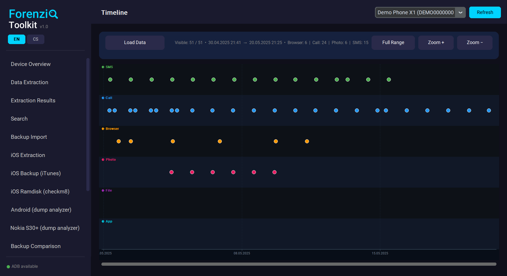

Shows SMS, calls, browser history, photos, files and app events on a time axis, one lane per source.

| Action | Effect |
|---|---|
| **Load Data** | choose an output folder (after an extraction it loads automatically) |
| Drag with the **left mouse button** | pan along the time axis |
| **Mouse wheel** | zoom in / out at the cursor |
| **Right click**, **Full Range** | show the whole time range |
| **Zoom + / Zoom –** | zoom buttons |
| **Click a dot** | event detail (source, date, time, all fields) |
| Source check boxes | show / hide sources |

Nearby events are merged into a larger dot with a count – zoom in to separate them.

---

## 18. GPS Location Map

Displays the locations of photos with GPS coordinates on an OpenStreetMap map, with a list of photos and
a detail panel (file name, date taken, coordinates, altitude, camera, resolution, size).

> ⚠ The map **downloads map tiles from the internet** (OpenStreetMap). Tile requests reveal the viewed
> area to the tile server. Do not open the Map if the case requires a fully offline workstation.
> The map shows up to 300 markers; the list up to 250 photos.

---

## 19. Screen Lock Bypass

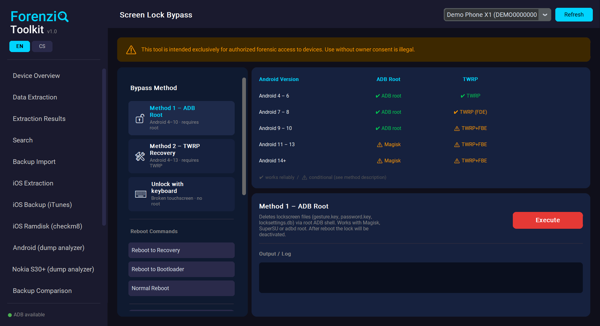

> ⚠ Only for devices you are legally authorised to access.

| Method | Requirements | Description |
|---|---|---|
| **Method 1 – ADB Root** | Android 4–10, root | deletes lock files (`gesture.key`, `password.key`, `locksettings.db`) |
| **Method 2 – TWRP Recovery** | Android 4–13, TWRP | mounts `/data` in TWRP and deletes lock files; FBE devices need a TWRP build with decryption |
| **Unlock with keyboard** | broken touchscreen, no root | enters a **known** PIN, password or pattern over ADB – not a lock crack |
| **FRP-1 – ADB Settings** | Android 5–6 | settings manipulation over ADB |
| **FRP-2 – TWRP wipe FRP** | Android 5–13, TWRP | zeroes the FRP partition |
| **FRP-3 – Fastboot erase** | unlocked bootloader | `fastboot erase frp` |
| **FRP-4 – Root: delete account** | Android 5–10, root | removes the Google account from `accounts.db` |

The compatibility table shows which method is reliable for which Android version. **Reboot commands**
(Recovery, Bootloader, normal reboot) are in the left panel.

---

## 20. Settings (report branding)

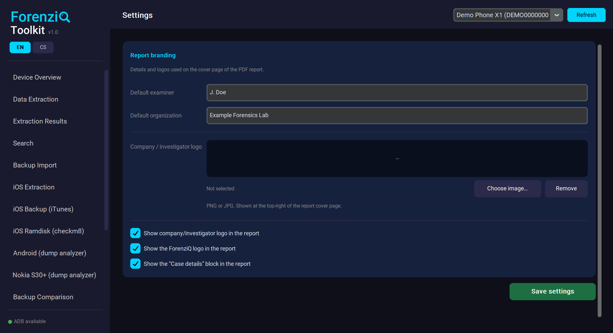

- **Default examiner** and **Default organization** – pre-filled into the case details of reports.
- **Company / investigator logo** (PNG or JPG) – printed top-right on the PDF cover page.
- Switches: show the company logo, the ForenziQ logo and the *Case details* block in the report.

Settings are stored in `%USERPROFILE%\.forenziq\settings.json`.

---

## 21. Wireless connection (Wi-Fi ADB)

1. Connect the device via USB first.
2. Open **Wi-Fi connection** in the sidebar and click **Activate TCP/IP** (port 5555).
3. Click **Detect IP** (or type the device IP address).
4. Click **Connect via Wi-Fi** – the USB cable can now be disconnected.

The computer and the device must be on the same network.

---

## 22. Recommended workflow

```
1. Preparation        – authorisation, USB debugging / backup / dump ready
2. Identification     – Device Overview: note model, IMEI, serial number
3. Acquisition        – Data Extraction, Backup Import, iOS, Android dump or S30+
4. Integrity          – Results → Evidence manifest (right after acquisition)
5. Analysis           – Search, Timeline, Map, Comparison
6. Reporting          – Results → HTML / PDF / Excel
7. Final check        – Results → Verify integrity
```

---

## 23. Data handling and privacy

- All acquisition and analysis runs **locally**. ForenziQ has no telemetry, no update check and no cloud
  features.
- The only module that contacts the internet is the **Map** (OpenStreetMap tiles).
- Extracted data, reports, the search index (`_case/`) and the evidence manifest are written only to the
  output folder you choose. Temporary files used for encrypted iOS backups are deleted after the import.

---

## 24. Troubleshooting

| Problem | Solution |
|---|---|
| Device not detected | enable USB debugging, confirm the prompt on the phone, use a data cable, install the USB driver, run `adb kill-server` and **Refresh** |
| Extraction fails or returns little data | unlock the device, confirm permission prompts, check free disk space |
| *Deleted Data* / WhatsApp modules return nothing | they require root access |
| iOS device not found | install pymobiledevice3, unlock the device and tap **Trust** |
| iOS backup – wrong password | the backup password is the one set in iTunes/Finder, not the device passcode |
| Android dump – "unsupported" | the data partition is encrypted (FBE/FDE) or uses another file system; ext4 and F2FS are supported |
| Map is empty | photos have no GPS data, or there is no internet connection |
| Timeline / Search is empty | open the output folder of an extraction (it must contain the module `.json` files) |
| Search finds nothing for a number | type at least 7 digits; formats do not matter |

---

*ForenziQ v1.0 · User Guide (EN)*
