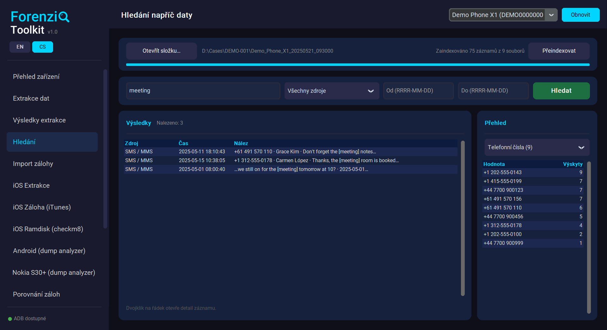
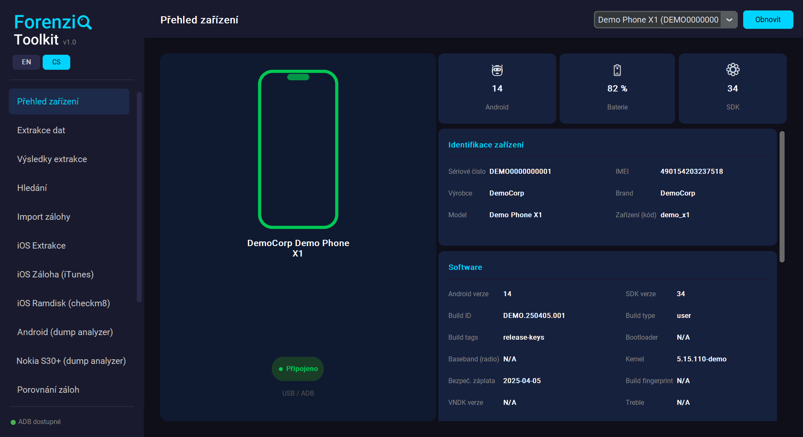
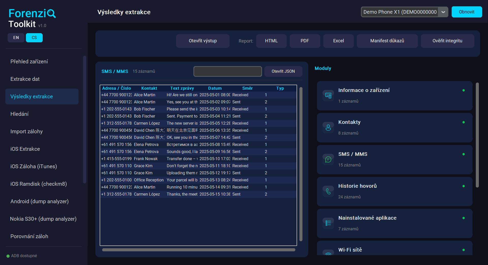
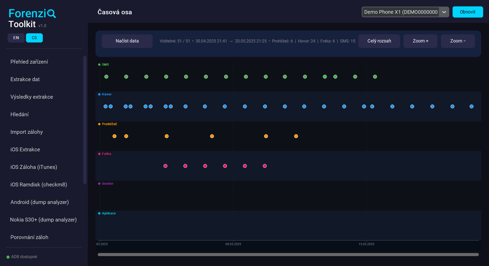
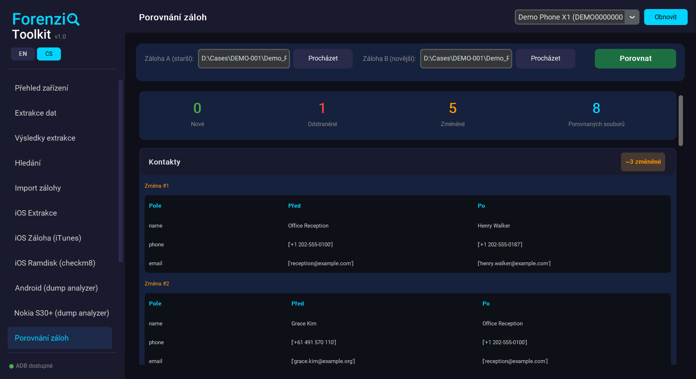
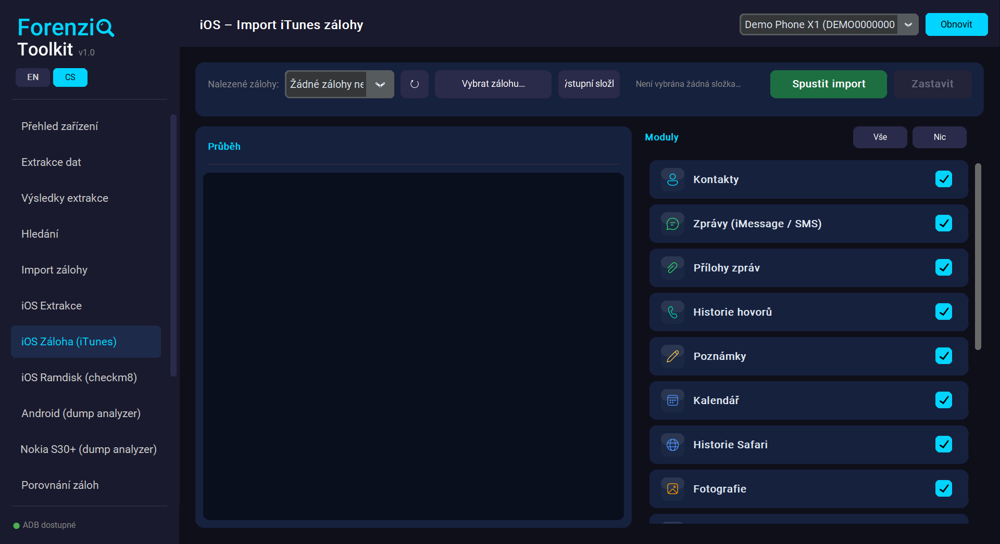
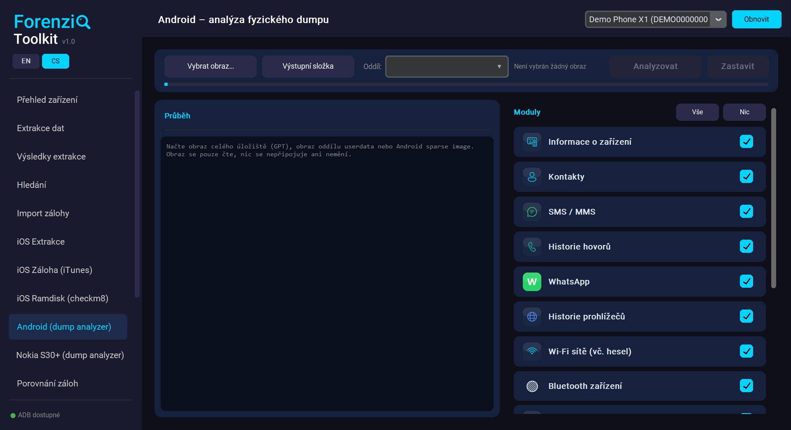

# ForenziQ Toolkit &nbsp; <a href="https://buymeacoffee.com/jelenl"></a>

**Desktopová sada nástrojů pro forenzní zajištění a analýzu dat z mobilních zařízení – Android, iOS a Nokia S30+.**

🇬🇧 [English version](README.md) · 📖 [Uživatelská příručka (CS)](MANUAL_CS.md) · 📖 [User Guide (EN)](MANUAL_EN.md)



> Snímky obrazovky ukazují **fiktivní ukázkový případ** – žádná reálná data.

---

## Funkce

**Akvizice**
- **Android přes ADB** (USB nebo Wi-Fi) – kontakty, SMS/MMS, hovory, aplikace, fotky a videa, dokumenty,
  Wi-Fi sítě, účty, historie prohlížeče, celý strom `/sdcard`, EXIF/GPS, hashe souborů; moduly s rootem
  pro smazaná data, WhatsApp a Viber
- **Fyzické dumpy Androidu** – raw / GPT / sparse obrazy, vlastní čtení ext4 pouze pro čtení (bez připojování)
- **Zálohy Androidu** – ADB `.ab` a zálohy Xiaomi MIUI (**včetně šifrovaných heslem**), Google Takeout;
  automatické rozpoznání záloh Samsung, Huawei, OPPO/realme, Vivo, Motorola, LG, Sony a OnePlus
  (viz [omezení](#stav-a-omezení))
- **iOS** – živá extrakce (pymobiledevice3), zálohy iTunes/Finder **včetně šifrovaných** (WhatsApp,
  iMessage, …), akvizice přes SSH ramdisk (checkm8)
- **Nokia S30+** – flash dumpy tlačítkových telefonů se Spreadtrum SC6531E (kontakty, SMS, hovory, soubory FAT12)

**Analýza**
- **Hledání napříč všemi zdroji** – fulltext nezávislý na diakritice a jazyku (včetně čínštiny,
  japonštiny, korejštiny, thajštiny), telefonní čísla v libovolném národním i mezinárodním tvaru,
  automatické rozpoznání e-mailů, URL, IBAN, kryptoadres, IMEI, platebních karet a IP adres
- **Časová osa** zpráv, hovorů, historie prohlížeče a fotek
- **Mapa GPS** míst pořízení fotek
- **Porovnání záloh** – nové / odstraněné / změněné záznamy mezi dvěma extrakcemi

**Reporty a integrita**
- HTML, **PDF** (titulní strana s údaji o případu a logy, klikací obsah, záložky) a Excel
- **Manifest důkazů** (MD5 + SHA-256 každého souboru) a ověření integrity
- Rozhraní v **angličtině** a **češtině**

| | |
|---|---|
|  |  |
|  |  |
|  |  |

---

## Rychlý start

**Stažení** – hotový `ForenziQ.exe` (bez nutnosti instalovat Python) najdete na stránce
[Releases](https://github.com/jelen-forensic-tools/ForenziQ-Toolkit/releases/latest).

> **Upozornění Windows:** `.exe` zatím není digitálně podepsaný. Windows SmartScreen může zobrazit
> *„Systém Windows ochránil váš počítač“* – klikněte na **Další informace → Přesto spustit**. Pokud je zapnuté
> **Inteligentní řízení aplikací** (Smart App Control), Windows může soubor úplně zablokovat; v tom případě
> spusťte ForenziQ ze zdrojových kódů (viz níže). Stažený soubor můžete ověřit podle hashe SHA-256
> zveřejněného u každého vydání: `Get-FileHash .\ForenziQ.exe -Algorithm SHA256` (PowerShell).

**Požadavky:** Windows 10/11 (64bit), Python 3.11+ (při spuštění ze zdrojových kódů).

```bash
pip install -r requirements.txt
python main.py
```

nebo spusťte `run.bat`. Pro Android stáhněte [SDK Platform-Tools](https://developer.android.com/tools/releases/platform-tools) a rozbalte je do složky
`adb/` v projektu (nebo je přidejte do `PATH`) – ADB není součástí tohoto repozitáře.

**Samostatný spustitelný soubor** – sestavení jediného `ForenziQ.exe` (na cílovém PC není potřeba Python):

```bash
pip install pyinstaller
python -m PyInstaller ForenziQ.spec --noconfirm --clean
```

Podrobný postup pro každý modul najdete v [uživatelské příručce](MANUAL_CS.md).

---

## Na čem je postaven

| Komponenta | Účel |
|---|---|
| Python 3.11+ | Aplikace |
| CustomTkinter | Uživatelské rozhraní (tmavý motiv) |
| Pillow | Obrázky, EXIF metadata |
| ReportLab | PDF reporty |
| openpyxl | Export do Excelu |
| deepdiff | Porovnání záloh |
| tkintermapview | Interaktivní mapa (OpenStreetMap) |
| cryptography | Dešifrování šifrovaných iOS záloh |
| SQLite FTS5 (součást Pythonu) | Index hledání |
| pymobiledevice3 *(volitelný)* | Živá extrakce iOS |
| paramiko *(volitelný)* | iOS SSH ramdisk |
| ADB | Komunikace se zařízeními Android |

---

## Soukromí

Veškerá akvizice i analýza probíhá **lokálně** – bez telemetrie, bez kontroly aktualizací, bez cloudu.
Jediný přístup do sítě má **Mapa**, která stahuje dlaždice OpenStreetMap. Výstupy, reporty a index
hledání se zapisují jen do výstupní složky, kterou zvolíte.

---

## Stav a omezení

- Analýza Android dumpů, dešifrování šifrovaných iOS záloh a modul iOS ramdisk byly testovány na
  syntetických datech – před použitím v případu je ověřte na známých referenčních datech.
- Android dumpy: pouze ext4 (F2FS a šifrovaná data FBE/FDE se ohlásí jako nepodporovaná).
- Nokia S30+: pouze Spreadtrum SC6531E (MOCOR).
- Import záloh: ADB `.ab` a zálohy Xiaomi MIUI (včetně šifrovaných) a Google Takeout se načtou;
  zálohy Samsung Smart Switch a Huawei HiSuite se rozpoznají, ale jejich šifrovaná data zatím nejde
  dešifrovat.

---

## Právní upozornění a odmítnutí odpovědnosti

> **DŮLEŽITÉ – PŘEČTĚTE PŘED POUŽITÍM**

Software je určen **výhradně pro zákonnou forenzní analýzu** zařízení, ke kterým máte výslovné oprávnění –
například vlastní zařízení, analýza se souhlasem vlastníka nebo na základě soudního příkazu, autorizované
bezpečnostní testování, výuka a výzkum v kontrolovaném prostředí.

**Použití bez takového oprávnění je protiprávní** a může porušovat trestní právo vaší jurisdikce. Autor
**nenese žádnou odpovědnost** za přímé, nepřímé, nahodilé ani následné škody vzniklé použitím nástroje
ani za jakékoli protiprávní jednání uživatele. Veškerá odpovědnost za způsob použití leží výhradně na
uživateli.

Stažením, instalací nebo spuštěním softwaru potvrzujete, že jste se s tímto upozorněním seznámili
a souhlasíte s ním.

---

## Licence

ForenziQ je licencován pod **[PolyForm Noncommercial License 1.0.0](LICENSE)**.

- ✅ Volně k použití, studiu, úpravám a sdílení pro **nekomerční** účely – osobní použití, výzkum,
  výuka a použití státními institucemi, organizacemi pro veřejnou bezpečnost (např. policií),
  neziskovými organizacemi a vzdělávacími či veřejnými výzkumnými institucemi.
- ❌ **Komerční použití není povoleno** – včetně prodeje softwaru, upravených verzí či odvozených děl,
  jejich zahrnutí do placeného produktu nebo služby a použití pro placenou komerční činnost.
- 💼 Pro komerční použití kontaktujte autora přes GitHub kvůli samostatné komerční licenci.

Software je poskytován „tak, jak je“, bez jakékoli záruky (viz [LICENSE](LICENSE)). Závazné je
anglické znění licence.

**Komponenty třetích stran:** Android SDK Platform-Tools (ADB) od společnosti Google nejsou součástí
tohoto repozitáře; pokud jsou přibalené do `ForenziQ.exe`, řídí se vlastními podmínkami Googlu a výše
uvedená licence se na ně nevztahuje.
