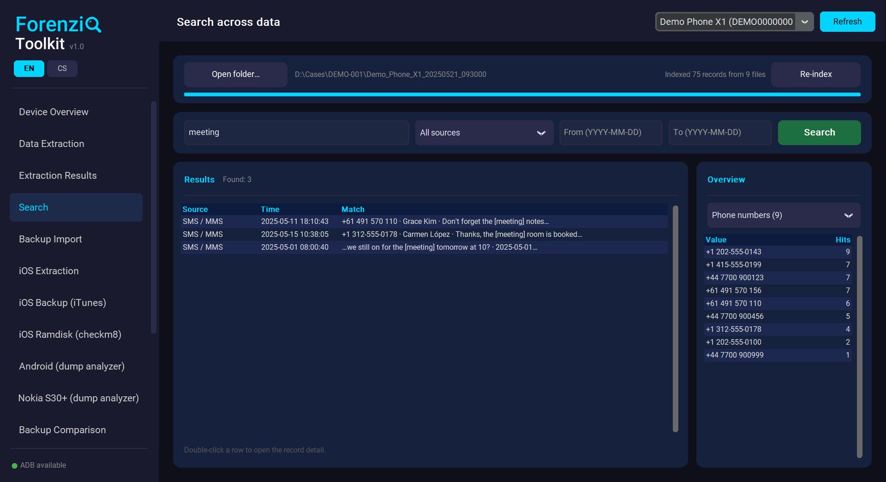
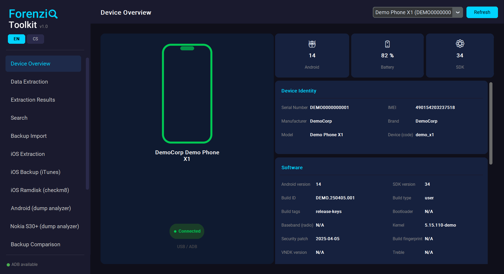
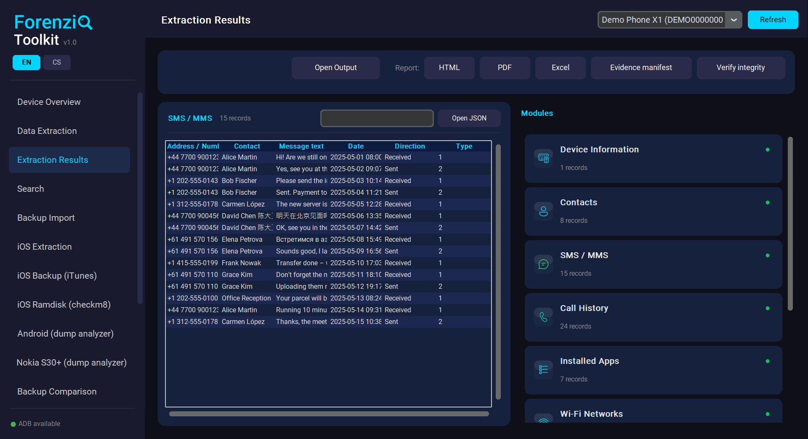
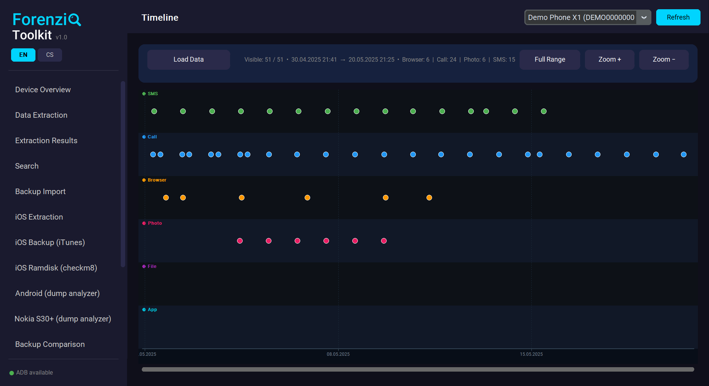
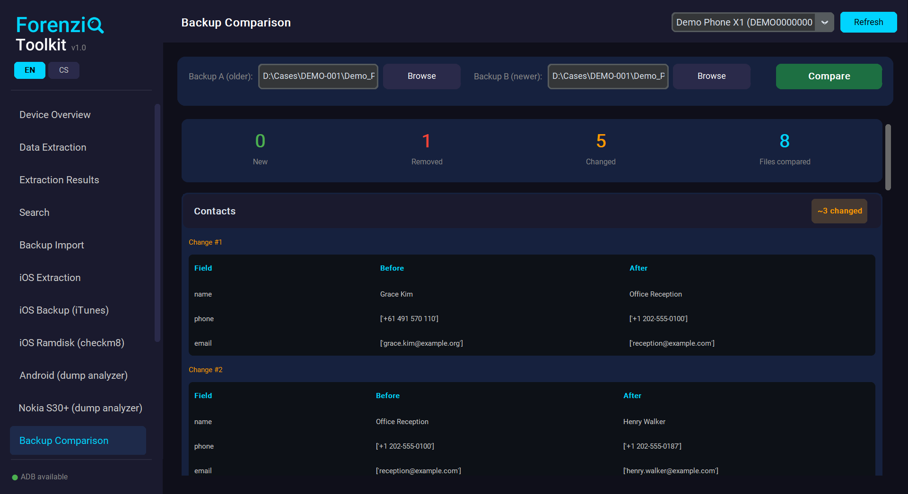
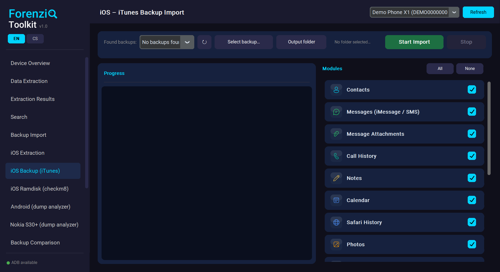
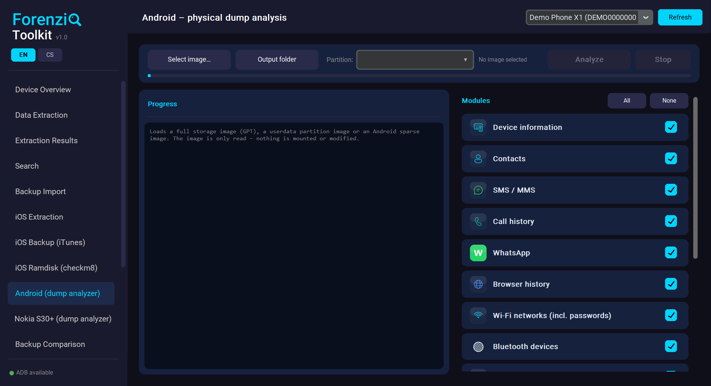

# ForenziQ Toolkit

**A desktop toolkit for forensic acquisition and analysis of mobile devices – Android, iOS and Nokia S30+.**

🇨🇿 [Česká verze](README.cs.md) · 📖 [User Guide (EN)](MANUAL_EN.md) · 📖 [Uživatelská příručka (CS)](MANUAL_CS.md)



> Screenshots show a **fictitious demo case** – no real data.

---

## Features

**Acquisition**
- **Android over ADB** (USB or Wi-Fi) – contacts, SMS/MMS, calls, apps, photos & videos, documents,
  Wi-Fi networks, accounts, browser history, the full `/sdcard` tree, EXIF/GPS, file hashes; root modules
  for deleted data, WhatsApp and Viber
- **Android physical dumps** – raw / GPT / sparse images, read-only ext4 parser (no mounting)
- **Android vendor backups** – Samsung SmartSwitch, Huawei HiSuite, Xiaomi MIUI, Google Takeout, Sony,
  OnePlus, OPPO/realme, Vivo, Motorola, LG, ADB `.ab` – with format auto-detection
- **iOS** – live extraction (pymobiledevice3), iTunes/Finder backups **including encrypted backups**
  (WhatsApp, iMessage, …), SSH-ramdisk acquisition (checkm8)
- **Nokia S30+** feature phones – Spreadtrum SC6531E flash dumps (contacts, SMS, calls, FAT12 files)

**Analysis**
- **Search across all sources** – accent- and language-independent full-text search (incl. Chinese,
  Japanese, Korean, Thai), phone numbers matched in any national/international format, automatic
  detection of e-mails, URLs, IBANs, crypto addresses, IMEIs, payment cards and IP addresses
- **Timeline** of messages, calls, browser history and photos
- **GPS map** of photo locations
- **Backup comparison** – new / removed / changed records between two extractions

**Reporting & integrity**
- HTML, **PDF** (cover page with case details and logos, clickable table of contents, bookmarks) and Excel
- **Evidence manifest** (MD5 + SHA-256 of every file) and integrity verification
- User interface in **English** and **Czech**

| | |
|---|---|
|  |  |
|  |  |
|  |  |

---

## Quick start

**Requirements:** Windows 10/11 (64-bit), Python 3.11+ (when running from source).

```bash
pip install -r requirements.txt
python main.py
```

or run `spustit.bat`. For Android, download [SDK Platform-Tools](https://developer.android.com/tools/releases/platform-tools) and extract them into an
`adb/` folder in the project (or add them to `PATH`) – ADB is not part of this repository.

**Standalone executable** – build a single-file `ForenziQ.exe` (no Python needed on the target PC):

```bash
pip install pyinstaller
python -m PyInstaller ForenziQ.spec --noconfirm --clean
```

See the [User Guide](MANUAL_EN.md) for step-by-step instructions for every module.

---

## Built with

| Component | Purpose |
|---|---|
| Python 3.11+ | Application |
| CustomTkinter | User interface (dark theme) |
| Pillow | Images, EXIF metadata |
| ReportLab | PDF reports |
| openpyxl | Excel export |
| deepdiff | Backup comparison |
| tkintermapview | Interactive map (OpenStreetMap) |
| cryptography | Decrypting encrypted iOS backups |
| SQLite FTS5 (built-in) | Search index |
| pymobiledevice3 *(optional)* | Live iOS extraction |
| paramiko *(optional)* | iOS SSH ramdisk |
| ADB | Android device communication |

---

## Privacy

All acquisition and analysis runs **locally** – no telemetry, no update checks, no cloud. The only
network access is the **Map**, which downloads OpenStreetMap tiles. Output, reports and the search
index are written only to the output folder you choose.

---

## Status and limitations

- The Android dump parser, encrypted iOS backup decryption and the iOS ramdisk module were tested with
  synthetic data – validate them against known reference data before relying on them in a case.
- Android dumps: ext4 only (F2FS and FBE/FDE-encrypted user data are reported as unsupported).
- Nokia S30+: Spreadtrum SC6531E (MOCOR) only.

---

## Legal notice and disclaimer

> **IMPORTANT – READ BEFORE USE**

This software is intended **exclusively for lawful forensic analysis** of devices for which you have
explicit authorisation – for example your own device, analysis with the owner's consent or on the basis
of a court order, authorised security testing, or education and research in a controlled environment.

**Using this software without such authorisation is illegal** and may violate the criminal law of your
jurisdiction. The author **accepts no responsibility or liability** for any direct, indirect, incidental
or consequential damage arising from the use of this tool, or for any unlawful action of the user.
All responsibility for the manner of use lies solely with the user.

By downloading, installing or running this software you confirm that you have read this notice and agree
to these terms.

---

## License

ForenziQ is licensed under the **[PolyForm Noncommercial License 1.0.0](LICENSE)**.

- ✅ Free to use, study, modify and share for **noncommercial** purposes – personal use, research,
  education, and use by government institutions, public safety organisations (e.g. police),
  charities and educational or public research institutions.
- ❌ **Commercial use is not permitted** – including selling the software, modified versions or
  derived works, bundling it into a paid product or service, or using it for paid commercial work.
- 💼 For commercial use, please contact the author via GitHub for a separate commercial license.

The software is provided "as is", without any warranty (see [LICENSE](LICENSE)).

**Third-party components:** Android SDK Platform-Tools (ADB) by Google are not part of this repository;
when bundled into `ForenziQ.exe` they remain under Google's own terms and are not covered by the license
above.
